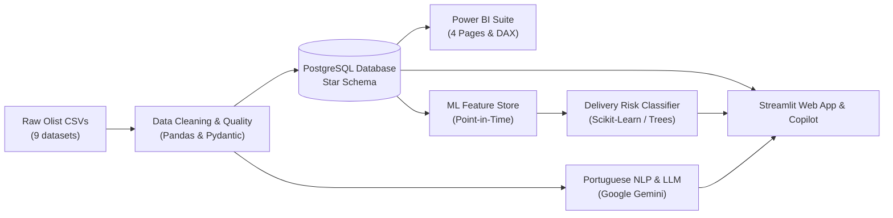

# CommerceLens AI

**Enterprise E-Commerce Analytics, Relational Modeling, Delivery-Risk Machine Learning & Evidence-Grounded AI Copilot**

[](https://www.python.org/)
[](https://www.postgresql.org/)
[](https://powerbi.microsoft.com/)
[](https://streamlit.io/)
[](https://www.kaggle.com/datasets/olistbr/brazilian-ecommerce)
[](#roadmap)
[-brightgreen.svg)](#roadmap)

---

## 1. Project Objective

**CommerceLens AI** is an interview-ready, end-to-end Data Analytics, Data Engineering, and Applied AI platform built on the public Brazilian E-Commerce dataset ([Olist](https://www.kaggle.com/datasets/olistbr/brazilian-ecommerce)). 

Rather than presenting an isolated notebook or superficial dashboard, this platform demonstrates the full analytics engineering lifecycle:
1. **Data Engineering & Quality Auditing**: Ingesting, profiling, validating referential integrity, and cleaning messy marketplace transactions.
2. **PostgreSQL Relational Modeling**: Designing a Kimball Star Schema, implementing fan-out-safe Common Table Expressions (CTEs), and computing verified business KPIs.
3. **Power BI Reporting Suite**: Delivering an executive-ready, 4-page dashboard with robust DAX measures, drill-downs, and Pareto category intelligence.
4. **Machine Learning (Delivery-Risk Prediction)**: Building a leakage-free classification model predicting late deliveries using strictly point-in-time features available at purchase/approval.
5. **NLP & Customer Intelligence**: Mining Brazilian Portuguese customer reviews for themes, sentiment, and logistics impact with Gemini models and localized NLP.
6. **Analytics Copilot & Streamlit Platform**: Providing business stakeholders with an interactive dashboard and an evidence-grounded natural-language query assistant bounded by approved SQL queries.

---

## 2. Architecture & Tech Stack



| Domain | Technology / Tool | Purpose |
|:---|:---|:---|
| **Programming** | Python 3.12 | Core processing, pipelines, and application logic |
| **Data Manipulation** | Pandas, NumPy | Cleaning, exploratory analysis, and feature transformations |
| **Relational Database** | PostgreSQL, SQLAlchemy, Psycopg2 | Star-schema storage, DDL constraints, and analytical SQL queries |
| **Business Intelligence** | Microsoft Power BI | Executive KPI reporting, DAX measures, and category diagnostics |
| **Machine Learning** | Scikit-learn, Joblib | Late-delivery classification, pipelines, and threshold optimization |
| **NLP & LLM** | Google Gemini API (Structured JSON) | Brazilian Portuguese review theme extraction & Copilot |
| **App & Interface** | Streamlit, Plotly | Interactive analytics application and copilot interface |
| **Engineering & Tests** | Pytest, Ruff | Automated testing, linting, and structural verification |

---

## 3. Repository Structure

```text
CommerceLens-AI/
├── AGENTS.md                   # Persistent engineering guidelines, rules, and governance
├── README.md                   # Project overview, setup guide, and architectural summary
├── .gitignore                  # Git exclusions (protecting raw data, env, caches)
├── .env.example                # Template for database & LLM environment credentials
├── pyproject.toml              # Build specifications, dependencies, and pytest configuration
├── data/
│   ├── raw/                    # Raw Olist CSV files (manually placed; ignored by git)
│   └── processed/              # Cleaned, validated Parquet/CSV tables (ignored by git)
├── notebooks/                  # Exploratory analysis and prototyping notebooks
├── src/
│   └── commercelens/           # Modular application source code
│       ├── __init__.py         # Package root with version metadata
│       ├── data/               # Ingestion, cleaning, and data quality modules
│       ├── analytics/          # Business metrics calculations and SQL runners
│       ├── ml/                 # Delivery-risk feature store, pipeline, evaluation, predict
│       ├── llm/                # Review sentiment analysis, PII redaction, Gemini client, cache
│       └── app/                # Streamlit user interface components
├── sql/
│   ├── schema/                 # PostgreSQL DDL table definitions and indexes
│   ├── analysis/               # Window functions, CTEs, and KPI queries
│   └── views/                  # Reporting views and semantic aggregation layers (01 & 02)
├── dashboards/
│   └── powerbi/                # Power BI Project (.pbip), TMDL semantic model, DAX & M scripts
├── docs/
│   ├── PROJECT_PLAN.md         # Comprehensive 8-phase execution roadmap
│   ├── DATABASE_DESIGN.md      # Kimball Star Schema ER diagram, table grains & anti-fan-out
│   ├── SQL_ANALYTICS_GUIDE.md  # Analytical queries, window functions & semantic views guide
│   ├── DATA_DICTIONARY.md      # Grain, types, and caveats for all 9 Olist tables
│   ├── METRICS.md              # Rigorous KPI definitions, formulas, and fan-out prevention
│   ├── ARCHITECTURE.md         # End-to-end system design and security guardrails
│   ├── PHASE_1_INGESTION_REPORT.md # Reconciled data audit report
│   ├── POWERBI_DASHBOARD_SPEC.md # 4-page Power BI visual specifications and DAX formulas
│   ├── POWERBI_IMPLEMENTATION.md # Step-by-step setup, TMDL model, DAX & reconciliation guide
│   ├── ML_MODEL_CARD.md        # Enterprise model card, intended use, biases & caveats
│   ├── ML_FEATURE_DICTIONARY.md # 27 point-in-time features & forbidden leakage register
│   ├── ML_EVALUATION.md        # In-depth empirical evaluation, threshold & defense guide
│   ├── LLM_REVIEW_INTELLIGENCE.md # Phase 5 LLM pipeline architecture, caching & safety
│   ├── REVIEW_THEME_TAXONOMY.md # Controlled 15-theme taxonomy and quote grounding guide
│   └── REVIEW_INTELLIGENCE_EVALUATION.md # Sentiment, concordance, and delivery cohort analysis
├── scripts/                    # Automation utilities, database load, DAX verify, ML train & Review NLP
├── tests/
│   ├── __init__.py
│   ├── test_smoke.py           # Foundational structural and import smoke tests
│   ├── test_data_pipeline.py   # Data cleaning & ingestion pipeline tests
│   ├── test_analytics_db.py    # Database connection & credential masking tests
│   ├── test_postgres_integration.py # Live PostgreSQL queries & schema tests
│   ├── test_powerbi_artifacts.py # Power BI PBIP, TMDL, DAX & reconciliation tests
│   ├── test_ml_pipeline.py     # ML feature engineering, anti-leakage, split & serving tests
│   ├── test_review_intelligence.py # PII redaction, prompt injection, caching, schema & views tests
│   └── test_streamlit_app.py   # Streamlit UI, metric formatting, Copilot grounding & cohort tests
└── reports/
    ├── data_quality_report.md  # Generated data quality audits
    ├── model_artifacts/        # Persisted pipelines, metadata, metrics, and importance tables
    └── review_intelligence/    # Markdown intelligence reports, CSVs, and human audit template
```

---

## 4. Getting Started

### 4.1 Prerequisites
- **Operating System**: Windows 10/11, macOS, or Linux.
- **Python**: Python 3.11 or 3.12.
- **Database**: PostgreSQL 15+ (local or containerized).
- **Git**: Installed and configured.
- **Power BI Desktop**: Required to view and edit `.pbip` reports.

### 4.2 Local Environment Setup

1. **Clone or Navigate to the Workspace**:
   ```powershell
   git clone https://github.com/<your-username>/CommerceLens-AI.git
   cd CommerceLens-AI
   ```

2. **Create and Activate a Virtual Environment**:
   ```powershell
   python -m venv .venv
   .\.venv\Scripts\Activate.ps1
   ```

3. **Install Dependencies**:
   ```powershell
   pip install -e ".[dev]"
   ```

4. **Configure Environment Secrets**:
   ```powershell
   cp .env.example .env
   # Update .env with your local PostgreSQL credentials and Gemini API key when needed
   ```
   *Model Configuration*:
   - `GEMINI_MODEL=gemini-3.5-flash-lite`: Recommended default model offering high structured-output throughput and quota efficiency.
   - Fallback behavior: If `GEMINI_MODEL` is absent from `.env`, the pipeline gracefully falls back to `gemini-3.8-flash`.

5. **Database Initialization**:
   Ensure PostgreSQL is running with credentials configured in `.env`, then execute the verified database loading pipeline:
   ```powershell
   python -c "from pathlib import Path; from commercelens.analytics.db import create_db_engine; from commercelens.analytics.loader import run_full_database_pipeline; res = run_full_database_pipeline(create_db_engine(), Path('sql'), Path('data/processed')); print(res.message)"
   ```
   *Verify database population and referential integrity*:
   ```powershell
   python scripts/verify_live_postgres.py
   ```
   *(Alternatively, execute the DDL scripts in sequence via `psql`: `sql/schema/01_staging_schema.sql` through `03_load_dimensions_and_facts.sql` and `sql/views/01_analytical_views.sql`, as detailed in [docs/DATABASE_DESIGN.md](docs/DATABASE_DESIGN.md)).*

6. **Power BI Reporting Suite**:
   Open the Power BI Project file located at:
   `dashboards/powerbi/CommerceLens-Analytics.pbip`
   (Report definitions reside in `dashboards/powerbi/CommerceLens-Analytics.Report/`).
   See [docs/POWERBI_IMPLEMENTATION.md](docs/POWERBI_IMPLEMENTATION.md) for data source configuration, semantic model schema, and DAX measures.

7. **Run Smoke & Full Tests**:
   ```powershell
   # Run quick smoke tests
   pytest -m smoke

   # Run full test suite
   pytest -q
   ```

---

## 5. Phase 4: Machine Learning — Delivery-Risk Prediction

### 5.1 Objective & Prediction Target
Predict whether an e-commerce order will arrive late relative to Olist's estimated SLA date, using **only point-in-time information known when the order is placed**.

$$\text{is\_late} = \begin{cases} 1 & \text{if } \text{order\_delivered\_customer\_date} > \text{order\_estimated\_delivery\_date} \\ 0 & \text{if } \text{order\_delivered\_customer\_date} \le \text{order\_estimated\_delivery\_date} \end{cases}$$

- **Supervised Cohort**: $96,470$ historically measurable delivered orders ($7,826$ late, $8.11\%$ overall prevalence).
- **Transparent Exclusions**: Exactly 8 delivered orders missing delivery timestamps were excluded. Cancelled/in-transit orders are excluded from supervised evaluation because their ultimate delivery outcome is unobservable.
- **Strict Anti-Leakage Guardrail**: Carrier dispatch dates, transit times, delivery dates, review ratings, and review timestamps are strictly blocked by runtime validation (`validate_no_leakage()`).

### 5.2 Chronological Validation Design
To prevent future-information leakage and simulate real production forecasting, the dataset is partitioned chronologically by `order_purchase_timestamp`:
- **Training Set**: Inception (2016-09-15) to 2018-04-30 | $N = 71,118$ ($73.72\%$) | Late Prevalence = $8.79\%$
- **Validation Set**: 2018-05-01 to 2018-06-30 | $N = 12,845$ ($13.32\%$) | Late Prevalence = $4.97\%$
- **Holdout Test Set**: 2018-07-01 to 2018-08-29 | $N = 12,507$ ($12.96\%$) | Late Prevalence = $7.48\%$

### 5.3 Benchmark, Reconciliation & Governance Disclosures

The delivery-risk modeling pipeline was audited and benchmarked across linear regularization sweeps, tree models, and checkout-safe feature engineering (documented in [reports/model_artifacts/ml_improvement_phase2_report.md](reports/model_artifacts/ml_improvement_phase2_report.md)):

1. **Historical Baseline (27 Features)**:
   - The deployed model artifact (`model_pipeline.joblib`) uses 27 features with balanced Logistic Regression ($C=0.1$).
   - **Governance Status**: Retained in the application strictly as a historical comparison baseline and for software interface compatibility. **It is not approved for operational checkout-time scoring** because its predictor `seller_dispatch_sla_days` depends on post-purchase payment clearance timing (`order_approved_at + 144.0h`).
   - At its validation-selected threshold ($\tau^* = 0.72$), it achieves **validation precision 22.93%**, **recall 29.42%**, F1 0.2577, and accuracy 91.57%. On the exploratory test holdout, it achieves precision 10.37%, recall 32.05%, and F1 0.1567.
2. **Primary Research Candidate (34 Features, Unweighted)**:
   - The **34-feature unweighted Logistic Regression model ($C=0.1$)** is the primary research candidate. It purges all post-checkout leakage and engineers 8 checkout-safe predictors (`sla_tightness_km_per_day`, `sla_buffer_days_per_100km`, `package_density_g_cm3`, `is_heavy_package`, `is_sp_to_sp`, `freight_per_item`, `merchandise_per_item`, `purchase_month`).
   - On chronological validation data, it achieves **ROC-AUC 0.7918**, **PR-AUC 0.1821**, **precision 20.61%**, **recall 35.05%**, and **F1 0.2596** at the balanced operating threshold ($\tau = 0.18$), with Expected Calibration Error (ECE) of **3.25%** and Brier score of **0.0451**.
   - **Operating Trade-Off**: The selected threshold ($\tau=0.18$) intentionally trades raw accuracy ($90.05\%$ vs the $95.03\%$ all-on-time baseline) to detect late deliveries ($35.05\%$ caught, $224$ of $639$ delayed orders on validation).
   - **Exploratory Holdout Limitation**: Because the July–August 2018 test split was repeatedly analyzed during benchmark audits, test performance figures are strictly **exploratory**. The candidate has **not been approved for production integration** pending live shadow evaluation on uninspected post-2018 data.

| Model Specification | Features | Weighting | Validation Threshold ($\tau$) | Val ROC-AUC | Val PR-AUC | Val Precision | Val Recall | Val F1-Score | Val Brier | Operational Status |
| :--- | :---: | :---: | :---: | :---: | :---: | :---: | :---: | :---: | :---: | :--- |
| **All-On-Time Baseline** | 26 | N/A | 0.50 | 0.5000 | 0.0497 | 0.00% | 0.00% | 0.0000 | 0.0497 | Trivial majority reference (95.03% acc) |
| **Comparison Baseline** | 27 | Balanced | 0.72 | 0.7902 | 0.1779 | 22.93% | 29.42% | 0.2577 | 0.1897 | Retained in app; unapproved for checkout |
| **Safe Candidate** | 26 | Unweighted | 0.18 | 0.7835 | 0.1784 | 20.21% | 32.86% | 0.2503 | 0.0452 | Evaluated checkout-safe baseline |
| **Primary Research Candidate** | **34** | **Unweighted** | **0.18** | **0.7918** | **0.1821** | **20.61%** | **35.05%** | **0.2596** | **0.0451** | **Primary Research Candidate (Pending shadow run)** |

### 5.4 Model Reproduction & Testing

1. **Retrain and Evaluate Pipeline**:
   ```powershell
   python scripts/train_delivery_model.py
   ```
   *Generates fitted models and evaluation reports in `reports/model_artifacts/`.*

2. **Run Machine Learning Tests**:
   ```powershell
   pytest tests/test_ml_pipeline.py -v
   ```
   *Executes 21 unit tests covering zero leakage, chronological splitting, threshold monotonicity, and calibration.*

---

## 6. Phase 5: LLM Customer Review Intelligence

### 6.1 Objective & Population Scope
Mine Brazilian Portuguese customer review commentary using Google Gemini structured JSON outputs, verbatim evidence quotes, PII redaction, and relational star-schema persistence.

- **Total Source Reviews**: $99,224$ records ($98,410$ distinct `review_id`s; compound key `(review_id, order_id)` guarantees uniqueness).
- **Reviews with Customer Text (Eligible)**: $42,697$ records ($43.03\%$ of marketplace reviews).
- **Reviews without Text (Rating Only)**: $56,527$ records ($56.97\%$). Preserved as rating-only without generating synthetic text.

### 6.2 Verified Database Cohorts & Provenance (PostgreSQL)

As of verified audit at `2026-10-13T17:56:11Z`, `fact_review_analysis` contains **160 total analysis records**:
- **Completed Analyses ($N = 132$)**:
  - `mock-portuguese-nlp-v1`: $100$ completed (heuristic baseline cohort)
  - `gemini-3.8-flash`: $28$ completed (initial live pilot)
  - `gemini-3.5-flash-lite`: $4$ completed (targeted evaluation cohort)
- **Failed Analyses ($N = 28$)**:
  - `gemini-3.8-flash`: $28$ failed records preserved as failures due to rate limiting (HTTP 429) during initial recovery tests.
- **Unprocessed Eligible Reviews**: $42,537$ text-bearing reviews remain in `fact_reviews` awaiting future processing.

> [!IMPORTANT]
> **Immutability of Failed Records & Scientific Restraint**:
> - Failed records are **never** mixed into completed sentiment or theme analytics.
> - The 4 completed Flash-Lite records show high grounding quality and schema compliance, but this small sample does **not** statistically prove general model reliability across the 42k+ corpus.
> - Analysis results show strong correlation between delayed delivery and negative customer sentiment; however, correlation does not imply delivery delay is the sole root cause (defective items, seller responsiveness, and freight pricing also contribute).

### 6.3 Controlled 15-Theme Taxonomy
Downstream SQL analytics and Power BI dashboards group reviews into 15 controlled themes across 6 operational categories:
- **Delivery**: `delivery_delay`, `delivery_tracking`, `positive_delivery_experience`
- **Product**: `damaged_or_defective_product`, `product_not_as_described`, `missing_or_wrong_item`, `poor_product_quality`, `positive_product_experience`
- **Seller**: `seller_communication`, `positive_seller_experience`
- **Packaging**: `packaging_issue`
- **Payment & Pricing**: `payment_or_pricing`
- **Returns & Refunds**: `return_or_refund`
- **General**: `other`, `unclear`

### 6.4 Safe Dry-Run & Pilot Reproduction

1. **Zero-Cost Dry Run (Recommended)**:
   Inspect unattempted eligible reviews without consuming API quota:
   ```powershell
   python scripts/run_review_intelligence.py --dry-run
   ```

2. **Targeted Pilot Execution with Safe Limits**:
   ```powershell
   # Run with small batch limit
   python scripts/run_review_intelligence.py --limit 10
   ```

3. **Run Review Intelligence Test Suite**:
   ```powershell
   pytest tests/test_review_intelligence.py -v
   ```

---

## 7. Phase 6: Streamlit Web Platform & Grounded Analytics Copilot

### 7.1 Architecture & Core Pillars
The CommerceLens Streamlit Platform (`src/commercelens/app/main.py`) integrates all analytical layers into an interactive web interface:
- **Tab 1: Executive Analytics**: Live PostgreSQL star-schema metrics (Delivered GMV: R$ 13.22M, AOV: R$ 137.04, OTDR: 91.89%, LDR: 8.11%, Cancellation Rate: 0.63%, Unavailable Rate: 0.61%, Plotly monthly sales trends & category Pareto curves).
- **Tab 2: Delivery-Risk Forecaster**: Interactive point-in-time order simulator using the Phase 4 ML pipeline (`reports/model_artifacts/model_pipeline.joblib`), enforcing strict zero-leakage validation, disclosing temporal holdout performance decay (Test ROC-AUC: 0.6112 vs Val: 0.7902 at $\tau = 0.72$), and delivering actionable triage guidance.
- **Tab 3: Customer Sentiment Explorer**: Multi-cohort review analysis explorer supporting 4 distinct slices:
  - *All completed analyses* ($N = 132$)
  - *Gemini 3.5 Flash-Lite* ($N = 4$)
  - *Gemini 3.8 Flash* ($N = 28$)
  - *Mock Portuguese NLP* ($N = 100$)
  Features dynamic coverage metrics calculated against the $42,697$ text-bearing reviews, individual review cards with model provenance badges, PII masking, and explicit sample-size warnings.
- **Tab 4: Grounded Analytics Copilot**: Conversational interface mapping natural-language questions to 8 approved business analytics templates. Strictly forbids arbitrary LLM-generated SQL, transparently labeled as `🟢 Copilot Engine: SQL-Grounded (Vetted Views)`, and provides full SQL template and grain citations.

### 7.2 Launching the Application Locally
```powershell
# Launch Streamlit web platform
streamlit run src/commercelens/app/main.py
```

---

## 8. Governance, Security & Release Readiness

- **Zero Fabrication**: Baseline numbers, data sizes, model accuracies, and business findings are never invented. Results reflect actual execution outputs.
- **Join Fan-Out Prevention**: Strict enforcement of grain-aligned aggregation before joining tables (preventing double-counting in multi-item orders).
- **Leakage-Free Predictive Modeling**: Delivery-risk models use strictly point-in-time features available at order confirmation. Post-purchase transit timestamps are excluded from training features.
- **Grounded AI Copilot**: The LLM queries vetted SQL analytical views with parameterized controls—never arbitrary raw SQL execution.
- **Security & Secret Handling**:
  - API keys and database credentials are strictly loaded via `.env` (ignored by `.gitignore`).
  - **Security Item**: A local PostgreSQL connection credential appeared in an earlier development screenshot. While not exposed in Git history, users deploying in shared environments must rotate database passwords and ensure `.env` remains untracked.

---

## 9. Implementation Roadmap

| Phase | Description | Deliverables | Status |
|:---:|:---|:---|:---:|
| **0** | **Scaffolding & Governance** | Repo layout, documentation, governance rules, smoke test | **Completed** |
| **1** | **Data Ingestion & Quality** | CSV profiling, cleaning pipeline, quality audit report | **Completed** |
| **2** | **PostgreSQL & Modeling** | Star schema DDL, analytical queries, verified KPI views | **Completed** |
| **2A**| **Live Database Integration**| Live PostgreSQL 18 build, 64 passing tests, financial reconciliation | **Completed** |
| **3** | **Power BI Reporting Suite** | 4-page PBIP project, TMDL semantic model, 35 DAX measures | **Completed** |
| **4** | **ML Delivery-Risk Model** | Leakage-free feature pipeline, baseline & tree models, evaluation, serving | **Completed** |
| **5** | **NLP & Review Mining** | Portuguese text processing, Gemini LLM classification, caching, views | **Completed** |
| **6** | **Copilot & Streamlit App** | Multi-page Streamlit platform with grounded Copilot, 122 tests | **Completed** |
| **7** | **Finalization & Portfolio Release** | Multi-cohort sentiment analytics, Power BI DAX expansion, test defense | **Completed** |
