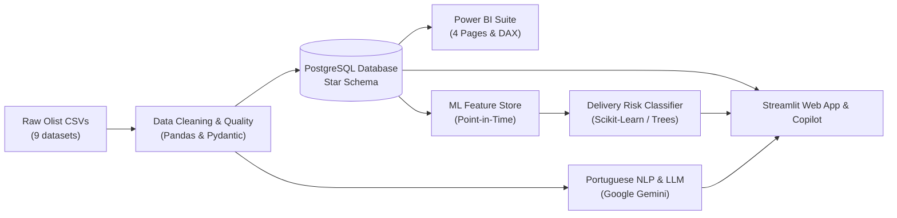

# CommerceLens AI

**Enterprise E-Commerce Analytics, Relational Modeling, Delivery-Risk Machine Learning & Evidence-Grounded AI Copilot**

[](https://www.python.org/)
[](https://www.postgresql.org/)
[](https://powerbi.microsoft.com/)
[](https://streamlit.io/)
[](https://www.kaggle.com/datasets/olistbr/brazilian-ecommerce)
[](#roadmap)

---

## 1. Project Objective

**CommerceLens AI** is an interview-ready, end-to-end Data Analytics, Data Engineering, and Applied AI platform built on the public Brazilian E-Commerce dataset ([Olist](https://www.kaggle.com/datasets/olistbr/brazilian-ecommerce)). 

Rather than presenting an isolated notebook or superficial dashboard, this platform demonstrates the full analytics engineering lifecycle:
1. **Data Engineering & Quality Auditing**: Ingesting, profiling, validating referential integrity, and cleaning messy marketplace transactions.
2. **PostgreSQL Relational Modeling**: Designing a Kimball Star Schema, implementing fan-out-safe Common Table Expressions (CTEs), and computing verified business KPIs.
3. **Power BI Reporting Suite**: Delivering an executive-ready, 4-page dashboard with robust DAX measures, drill-downs, and Pareto category intelligence.
4. **Machine Learning (Delivery-Risk Prediction)**: Building a leakage-free classification model predicting late deliveries using strictly point-in-time features available at purchase/approval.
5. **NLP & Customer Intelligence**: Mining Brazilian Portuguese customer reviews for themes, sentiment, and logistics impact.
6. **Analytics Copilot & Streamlit Platform**: Providing business stakeholders with an interactive dashboard and an evidence-grounded natural-language query assistant bounded by approved SQL queries.

---

## 2. Architecture & Tech Stack



| Domain | Technology / Tool | Purpose |
|:---|:---|:---|
| **Programming** | Python 3.12 | Core processing, pipelines, and application logic |
| **Data Manipulation** | Pandas, NumPy | Cleaning, exploratory analysis, and feature transformations |
| **Relational Database** | PostgreSQL, SQLAlchemy, Psycopg2 | Star-schema storage, DDL constraints, and analytical SQL queries |
| **Business Intelligence** | Microsoft Power BI | Executive KPI reporting, DAX measures, and category diagnostics |
| **Machine Learning** | Scikit-learn, CatBoost, SHAP | Late-delivery classification and explainability |
| **NLP & LLM** | Google Gemini API (Structured JSON) | Brazilian Portuguese review theme extraction & Copilot |
| **App & Interface** | Streamlit, Plotly | Interactive analytics application and copilot interface |
| **Engineering & Tests** | Pytest, Ruff | Automated testing, linting, and structural verification |

---

## 3. Repository Structure

```text
CommerceLens-AI/
├── AGENTS.md                   # Persistent engineering guidelines, rules, and governance
├── README.md                   # Project overview, setup guide, and architectural summary
├── .gitignore                  # Git exclusions (protecting raw data, env, caches)
├── .env.example                # Template for database & LLM environment credentials
├── pyproject.toml              # Build specifications, dependencies, and pytest configuration
├── data/
│   ├── raw/                    # Raw Olist CSV files (manually placed; ignored by git)
│   └── processed/              # Cleaned, validated Parquet/CSV tables (ignored by git)
├── notebooks/                  # Exploratory analysis and prototyping notebooks
├── src/
│   └── commercelens/           # Modular application source code
│       ├── __init__.py         # Package root with version metadata
│       ├── data/               # Ingestion, cleaning, and data quality modules
│       ├── analytics/          # Business metrics calculations and SQL runners
│       ├── ml/                 # Delivery-risk feature store and model training
│       ├── llm/                # Review sentiment analysis and Copilot agent
│       └── app/                # Streamlit user interface components
├── sql/
│   ├── schema/                 # PostgreSQL DDL table definitions and indexes
│   ├── analysis/               # Window functions, CTEs, and KPI queries
│   └── views/                  # Reporting views and semantic aggregation layers
├── dashboards/
│   └── powerbi/                # Power BI templates (.pbit), layout specs, and DAX measures
├── docs/
│   ├── PROJECT_PLAN.md         # Comprehensive 8-phase execution roadmap
│   ├── DATA_DICTIONARY.md      # Grain, types, and caveats for all 9 Olist tables
│   ├── METRICS.md              # Rigorous KPI definitions, formulas, and fan-out prevention
│   ├── ARCHITECTURE.md         # End-to-end system design and security guardrails
│   └── POWERBI_DASHBOARD_SPEC.md # 4-page Power BI visual specifications and DAX formulas
├── scripts/                    # Automation utilities and database load scripts
├── tests/
│   ├── __init__.py
│   └── test_smoke.py           # Foundational structural and import smoke tests
└── reports/                    # Generated data quality audits and model reports
```

---

## 4. Getting Started

### 4.1 Prerequisites
- **Operating System**: Windows 10/11, macOS, or Linux.
- **Python**: Python 3.11 or 3.12.
- **Git**: Installed and configured.

### 4.2 Local Environment Setup

1. **Clone or Navigate to the Workspace**:
   ```powershell
   cd c:\Users\Admin\Desktop\CommerceLens-AI
   ```

2. **Create and Activate a Virtual Environment**:
   ```powershell
   python -m venv .venv
   .\.venv\Scripts\Activate.ps1
   ```

3. **Install Dependencies**:
   ```powershell
   # Base and dev dependencies
   pip install -e ".[dev]"
   ```

4. **Configure Environment Secrets**:
   ```powershell
   cp .env.example .env
   # Update .env with your local PostgreSQL credentials and Gemini API key when needed
   ```

5. **Run Smoke Tests**:
   ```powershell
   pytest -m smoke
   ```

---

## 5. Development Principles & Data Ethics
- **Zero Fabrication**: Baseline numbers, data sizes, model accuracies, and business findings are never invented. Results reflect actual execution outputs.
- **Join Fan-Out Prevention**: Strict enforcement of grain-aligned aggregation before joining tables (preventing double-counting in multi-item orders).
- **Leakage-Free Predictive Modeling**: Delivery-risk models use strictly point-in-time features available at order confirmation. Post-purchase transit timestamps are excluded from training features.
- **Grounded AI Copilot**: The LLM queries vetted SQL analytical views with parameterized controls—never arbitrary raw SQL execution.

---

## 6. Implementation Roadmap

| Phase | Description | Deliverables | Status |
|:---:|:---|:---|:---:|
| **0** | **Scaffolding & Governance** | Repo layout, documentation, governance rules, smoke test | **Completed** |
| **1** | **Data Ingestion & Quality** | CSV profiling, cleaning pipeline, quality audit report | *Next Up* |
| **2** | **PostgreSQL & Modeling** | Star schema DDL, analytical queries, verified KPI views | *Planned* |
| **3** | **Power BI Reporting Suite** | 4-page interactive dashboard, DAX measure library | *Planned* |
| **4** | **ML Delivery-Risk Model** | Leakage-free feature pipeline, baseline & tree models, SHAP | *Planned* |
| **5** | **NLP & Review Mining** | Portuguese text processing, Gemini LLM classification | *Planned* |
| **6** | **Copilot & Streamlit App** | Multi-page Streamlit platform with grounded Copilot | *Planned* |
| **7** | **Validation & Defense** | End-to-end tests, interview defense FAQs, portfolio package | *Planned* |
