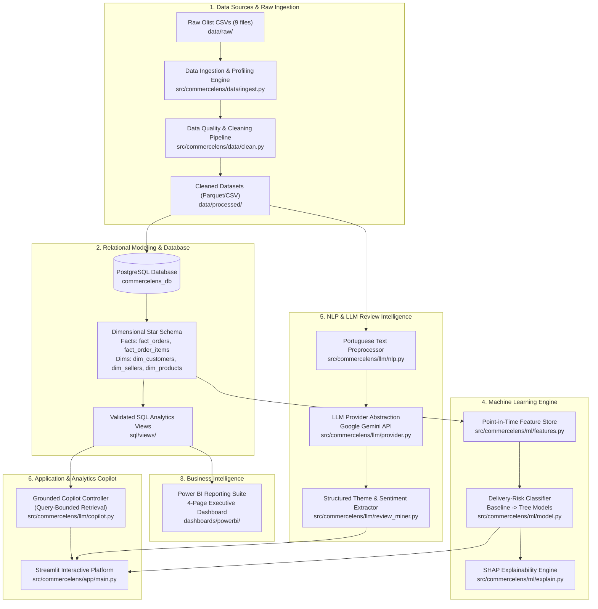

# CommerceLens AI — System Architecture & Design Specification

> **Platform Concept**: An enterprise-grade, interview-ready data platform combining automated data engineering, relational modeling (PostgreSQL), business intelligence (Power BI), predictive machine learning, and an evidence-grounded AI copilot.

---

## 1. High-Level Architectural Diagram

---

## 2. Layer-by-Layer Architectural Details

### 2.1 Layer 1: Ingestion & Data Quality Engineering
- **Component**: `src/commercelens/data/`
- **Pattern**: Deterministic, idempotent extraction and validation.
- **Responsibilities**:
  - Validates CSV headers, data types, and primary key constraints against `DATA_DICTIONARY.md`.
  - Audits missing timestamps, duplicate rows, and referential integrity between tables.
  - Normalizes Portuguese text characters and string encodings.
  - Emits parquet files to `data/processed/` and logs data quality metrics to `reports/data_quality_report.md`.

### 2.2 Layer 2: Relational Schema & SQL Semantic Layer
- **Component**: `sql/schema/`, `sql/views/`, `sql/analysis/`
- **Pattern**: Kimball Dimensional Modeling (Star Schema) hosted on PostgreSQL.
- **Architecture**:
  - **Fact Tables**:
    - `fact_order_items`: Granularity is `(order_id, order_item_id)`. Contains item price, freight, seller, product, and timestamps.
    - `fact_orders`: Granularity is `order_id`. Contains order-level aggregated metrics, total payment, delivery duration, and SLA status.
  - **Dimension Tables**:
    - `dim_customers`: Unique customer identity (`customer_unique_id`), location, and state.
    - `dim_sellers`: Seller location, state, and fulfillment metrics.
    - `dim_products`: Category translation (English/Portuguese), dimensions, weight.
    - `dim_date`: Calendar dimension for time-series slicing.
- **Fan-Out Barrier**: Pre-aggregated Common Table Expressions (CTEs) ensure that joins across items, payments, and reviews never create Cartesian explosions.

### 2.3 Layer 3: Power BI Business Intelligence Layer
- **Component**: `dashboards/powerbi/`
- **Pattern**: Direct or imported connection to PostgreSQL Star Schema.
- **Design Philosophy**:
  - One-way 1-to-many relationships (Dimensions filter Facts).
  - Explicit DAX measures (no implicit column aggregations).
  - Four dedicated business views: Executive, Sales & Category, Logistics Operations, and Customer Reviews.

### 2.4 Layer 4: Machine Learning Engine (Delivery-Risk Prediction)
- **Component**: `src/commercelens/ml/`
- **Constraint**: **Zero Target Leakage**.
- **Rules**:
  - Predictions are made at **order confirmation time**.
  - Permitted features: Customer state, seller state, geographic distance estimate, freight value, product weight/dimensions, order purchase day/month, historical seller on-time rate prior to order date.
  - Forbidden features: Carrier pickup date, transit milestones, delivery timestamp, review timestamp.
  - Evaluation: Chronological train/test split. Baseline comparison, PR-AUC, F1-Score, and SHAP feature importance.

### 2.5 Layer 5: NLP & LLM Review Intelligence
- **Component**: `src/commercelens/llm/`
- **Pattern**: Provider Abstraction with Structured Output.
- **Design**:
  - Language: Brazilian Portuguese text parsing with translation/multilingual LLM prompting.
  - Provider interface: Abstract class `LLMProvider` supporting Google Gemini (`gemini-1.5-flash`) and easily extensible to alternative endpoints.
  - Schema: Pydantic models for structured output (Sentiment, Root Cause Category, Logistics Delay Flag).
  - Validation: Audited against a benchmark sample ($N \ge 200$) before applying batch inference.

### 2.6 Layer 6: Analytics Copilot & Streamlit Platform
- **Component**: `src/commercelens/app/`
- **Copilot Safety Guardrail**:
  - The LLM **never** generates or executes arbitrary ad-hoc SQL strings.
  - Questions are mapped to a whitelist of parameterized analytics tools and validated SQL views.
  - Answers cite concrete numbers, sample sizes, and state analytical caveats (distinguishing correlation from causation).

---

## 3. Security, Confidentiality & Workspace Boundaries
1. **No Hard-Coded Credentials**: All secrets (database passwords, API keys) are strictly loaded via `.env` through `pydantic-settings` or `python-dotenv`.
2. **Local Data Isolation**: Raw data files and local database binaries are excluded from Git commits via `.gitignore`.
3. **Workspace Boundary**: Code and execution remain strictly constrained to `c:\Users\Admin\Desktop\CommerceLens-AI`.
