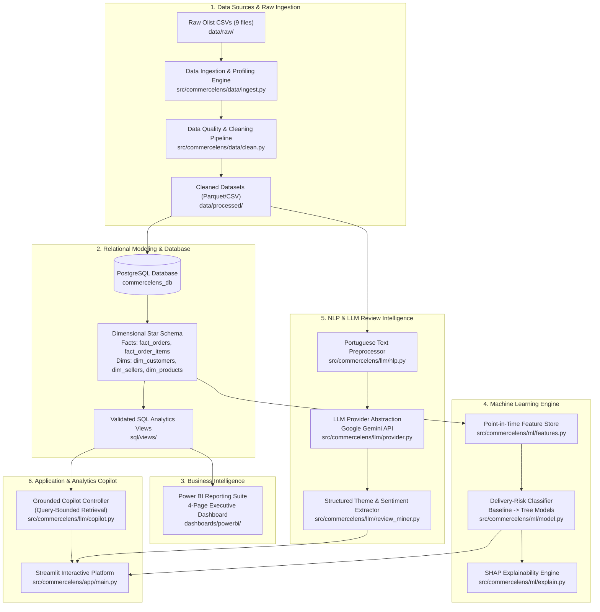

# CommerceLens AI — System Architecture & Design Specification

> **Platform Concept**: An enterprise-grade, interview-ready data platform combining automated data engineering, relational modeling (PostgreSQL), business intelligence (Power BI), predictive machine learning, and an evidence-grounded AI copilot.

---

## 1. High-Level Architectural Diagram

---

## 2. Layer-by-Layer Architectural Details

### 2.1 Layer 1: Ingestion & Data Quality Engineering
- **Component**: `src/commercelens/data/`
- **Pattern**: Deterministic, idempotent extraction and validation.
- **Responsibilities**:
  - Validates CSV headers, data types, and primary key constraints against `DATA_DICTIONARY.md`.
  - Audits missing timestamps, duplicate rows, and referential integrity between tables.
  - Normalizes Portuguese text characters and string encodings.
  - Emits parquet files to `data/processed/` and logs data quality metrics to `reports/data_quality_report.md`.

### 2.2 Layer 2: Relational Schema & SQL Semantic Layer
- **Component**: `sql/schema/`, `sql/views/`, `sql/analysis/`, `src/commercelens/analytics/`
- **Pattern**: Kimball Dimensional Modeling (Star Schema) hosted on PostgreSQL.
- **Architecture**:
  - **Fact Tables**:
    - `fact_orders`: Granularity is `order_id` (PK). Contains order lifecycle milestones, strict SLA eligibility flags (`is_eligible_for_sla`), and pre-aggregated commercial metrics.
    - `fact_order_items`: Granularity is `(order_id, order_item_id)`. Contains item price, freight value, product SKU, and seller.
    - `fact_payments`: Granularity is `(order_id, payment_sequential)`. Retains all payment methods, installment counts, and values (including 9 zero-value vouchers).
    - `fact_reviews`: Granularity is `(review_id, order_id)`. Compound key ensures 100% uniqueness over non-unique `review_id`s; tracks 1–5 CSAT ratings and Portuguese feedback.
  - **Dimension Tables**:
    - `dim_customers`: Order checkout session token (`customer_id`) mapped to persistent consumer identity (`customer_unique_id`), city, and state.
    - `dim_sellers`: Merchant business ID (`seller_id`), location, and regional distribution hub.
    - `dim_products`: SKU identifier, physical weight/dimensions, Portuguese category, and verified English translation.
    - `dim_geography`: Deduplicated median centroid coordinate reference (19,010 prefixes) eliminating raw 1:N coordinate fan-out.
    - `dim_date`: Calendar dimension for time-series slicing, quarter, month, and day-of-week aggregations.
- **Fan-Out Barrier**: Pre-aggregated Common Table Expressions (CTEs) ensure that joins across items, payments, and reviews never create Cartesian explosions ($N \times M$). Financial reconciliation verifies 0.00 variance across the entire database.
- **Python Utilities**: `src/commercelens/analytics/` provides `db.py` (connection management with credential masking), `loader.py` (batch staging load and ELT pipeline), and `kpis.py` (validated query runners and anti-fan-out proofs).

### 2.3 Layer 3: Power BI Business Intelligence Layer
- **Component**: `dashboards/powerbi/`
- **Pattern**: Direct or imported connection to PostgreSQL Star Schema.
- **Design Philosophy**:
  - One-way 1-to-many relationships (Dimensions filter Facts).
  - Explicit DAX measures (no implicit column aggregations).
  - Four dedicated business views: Executive, Sales & Category, Logistics Operations, and Customer Reviews.

### 2.4 Layer 4: Machine Learning Engine (Delivery-Risk Prediction)
- **Component**: `src/commercelens/ml/`
- **Pattern**: Leakage-free, chronological, pipeline-based supervised classification architecture.
- **Modules**:
  - `features.py`: Point-in-time extraction from PostgreSQL star schema, Haversine distance computation, Brazilian macro-region mapping, and strict anti-leakage validation (`validate_no_leakage`).
  - `split.py`: Temporal partitioning (`chronological_split_by_date`, `chronological_split_by_ratio`) enforcing strict chronological monotonicity ($T_{\text{train}} < T_{\text{val}} < T_{\text{test}}$) and zero cross-split observation overlap.
  - `pipeline.py`: Scikit-learn `Pipeline` and `ColumnTransformer` encapsulation fitting imputation (`SimpleImputer`), scaling (`StandardScaler`), and categorical encoding (`OneHotEncoder`) exclusively on training data.
  - `evaluate.py`: Imbalanced classification evaluation (PR-AUC, ROC-AUC, Brier score, Confusion Matrix) and validation-driven probability threshold tuning.
  - `explain.py`: Odds ratios, standardized coefficients, feature importances, subgroup error slicing (macro-regions, top product categories), and explicit causality disclaimers.
  - `predict.py`: Production-grade `DeliveryRiskPredictor` runtime class with input validation, automated feature synthesis, probability scoring, and calibrated risk-tier routing (`LOW`, `MEDIUM`, `HIGH`).
- **Core Governance & Safeguards**:
  - **Zero Target Leakage**: 11 forbidden post-purchase operational milestones (`order_delivered_customer_date`, carrier handover dates, transit lead times, review scores/timestamps, etc.) are strictly blocked from the feature matrix.
  - **Grain Integrity**: Order items are pre-aggregated to `order_id` grain prior to dimension joins, ensuring exactly 1 feature row per order with zero Cartesian product fan-out.
  - **Temporal Integrity**: Partitioning is strictly chronological: Train (2016-09-15 to 2018-04-30), Validation (2018-05-01 to 2018-06-30), and Holdout Test (2018-07-01 to 2018-08-29).
  - **Benchmarking & Selection**: Majority-class baseline (`DummyClassifier`), balanced L2 Logistic Regression, and tree-based ensembles (`RandomForestClassifier`, `HistGradientBoostingClassifier`). Logistic Regression was selected for enterprise production due to its robust generalization, non-overfitting characteristics under macroeconomic temporal drift, and defensible odds ratio interpretability.

### 2.5 Layer 5: NLP & LLM Review Intelligence
- **Component**: `src/commercelens/llm/`
- **Pattern**: Provider abstraction with strict Pydantic structured output, PII redaction, prompt injection defense, SHA-256 response caching, and relational star-schema persistence.
- **Modules**:
  - `schema.py`: Controlled 15-theme taxonomy, sentiment enums (`positive`, `neutral`, `negative`, `mixed`, `unclear`), confidence bands, and Pydantic models (`ReviewAnalysisOutput`, `ReviewAnalysisRecord`).
  - `redact.py`: Brazilian Portuguese text normalization, PII sanitization (redacting emails to `[EMAIL]`, phone numbers to `[PHONE]`, CPFs to `[CPF]`), and programmatic quote grounding verification (`is_quote_grounded`).
  - `prompts.py`: Versioned prompt templates (`PROMPT_VERSION = "v1.0"`), Portuguese taxonomy guidelines, and prompt injection defense treating customer reviews strictly as passive data.
  - `client.py`: `LLMClientBase` interface, `GeminiLLMClient` (using official `google.genai` SDK with native schema enforcement, rate-limiting, and bounded exponential backoff retries), and deterministic `MockLLMClient` for offline execution and regression testing.
  - `cache.py`: Atomic SHA-256 file cache (`reports/review_intelligence/.cache/`) keying text, model, and prompt version to eliminate redundant API token expenditure.
  - `persistence.py`: Idempotent PostgreSQL persistence into `fact_review_analysis` (parent table, compound key `(review_id, order_id)`) and `fact_review_themes` (normalized multi-label child table).
  - `pipeline.py`: `ReviewIntelligencePipeline` orchestrator with progress logging, batch persistence, and strict safe execution limits (default 100 reviews; `--all` required for full run).
  - `analytics.py`: Coverage statistics, sentiment distribution, rating-proxy concordance analysis, delivery-cohort cross-tabulation, and human double-blind audit template generator.
- **Relational Integration & Analytical Views**:
  - `sql/views/02_review_intelligence_views.sql`: Read-only views joining `fact_review_analysis` to `fact_orders`, `dim_products`, and `dim_customers` without join fan-out.
  - `dashboards/powerbi/dax_measures.dax`: 7 new DAX measures quantifying text-bearing review volume, text sentiment shares, and delivery complaint prevalence.

### 2.6 Layer 6: Analytics Copilot & Streamlit Platform
- **Component**: `src/commercelens/app/`
- **Pattern**: Multi-tab Streamlit web application uniting star-schema analytics, ML forecasting, review sentiment intelligence, and a grounded conversational copilot.
- **Modules**:
  - `main.py`: Streamlit application entry point (`streamlit run src/commercelens/app/main.py`), sidebar health checks, and global filters.
  - `components.py`: Shared UI design system, custom CSS, metric cards with complete value rendering, Plotly theme customization, and mock pilot alert banners.
  - `data.py`: Cached PostgreSQL access layer (`@st.cache_data(ttl=300)`) enforcing grain discipline and anti-fan-out CTEs.
  - `copilot.py`: `GroundedAnalyticsCopilot` engine mapping inquiries to 8 vetted business analytics templates, preventing arbitrary SQL execution.
  - `tabs/executive.py`: Tab 1 Executive Analytics dashboard (GMV, AOV, OTDR, LDR, monthly trends, Pareto category charts, state comparisons).
  - `tabs/forecaster.py`: Tab 2 Delivery Risk Forecaster with 27 point-in-time features, strict data leakage rejection, and holdout performance disclosures.
  - `tabs/sentiment.py`: Tab 3 Customer Sentiment Explorer with prominent mock pilot notices, delivery cohort comparisons, and PII-redacted review explorer.
  - `tabs/copilot_tab.py`: Tab 4 Grounded Analytics Copilot conversational UI with preset quick prompts, evidence preview tables, and SQL view provenance.
- **Copilot Safety Guardrail**:
  - The LLM **never** generates or executes arbitrary ad-hoc SQL strings.
  - Inquiries are deterministically mapped to an approved allowlist (`APPROVED_INTENTS`) with parameterized SQL templates.
  - Answers cite concrete numbers, sample sizes ($N$), declared table grain, and explicit statistical governance caveats.
  - Displays `OFFLINE COPILOT MODE` when `GEMINI_API_KEY` is not present, guaranteeing complete transparency.

---

## 3. Security, Confidentiality & Workspace Boundaries
1. **No Hard-Coded Credentials**: All secrets (database passwords, API keys) are strictly loaded via `.env` through `pydantic-settings` or `python-dotenv`.
2. **Local Data Isolation**: Raw data files and local database binaries are excluded from Git commits via `.gitignore`.
3. **Workspace Boundary**: Code and execution remain strictly constrained to `c:\Users\Admin\Desktop\CommerceLens-AI`.
