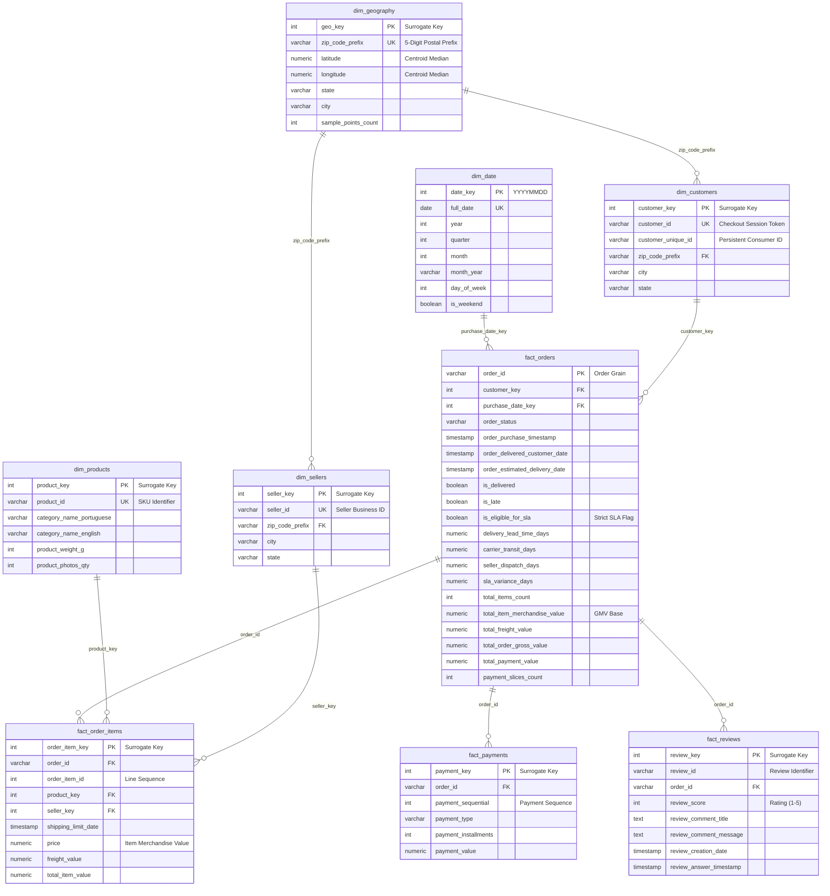

# CommerceLens AI — Relational Database Architecture & Dimensional Model

> **Layer**: Staging & Dimensional Analytical Storage (PostgreSQL / Kimball Star Schema)  
> **Status**: Production-Grade Schema Design & Validated ELT Pipeline Specification  
> **Dataset**: Brazilian E-Commerce Public Dataset (Olist, 2016–2018 Marketplace Snapshot)

---

## 1. Architectural Overview & Design Philosophy

CommerceLens AI employs a **two-tier relational architecture** designed specifically for high-performance analytical processing, business intelligence (Power BI semantic modeling), and LLM copilot retrieval:

1. **Staging Layer (`stg_*`)**:
   - Mirrors the grain and business keys of the cleaned Olist datasets.
   - Enforces strict data types (numeric amounts, dates/timestamps, integer counts/ratings, explicit boolean flags).
   - Serves as the landing and validation zone for ELT transformations.
2. **Analytics Dimensional Layer (`dim_*`, `fact_*`)**:
   - Modeled using the **Kimball Dimensional Modeling methodology (Star Schema)**.
   - Decomposes business events into distinct fact tables across natural operational grains (`fact_orders`, `fact_order_items`, `fact_payments`, `fact_reviews`).
   - Conforms dimensions (`dim_customers`, `dim_sellers`, `dim_products`, `dim_geography`, `dim_date`) across fact tables.
   - Eliminates Cartesian fan-out and double-counting of commercial measures through pre-aggregated CTE pipelines.

---

## 2. Entity-Relationship Diagram (Kimball Star Schema)



---

## 3. Dimensional Model Table Catalogue & Grain Definitions

### 3.1 Dimension Tables

| Table Name | Business Grain | Primary Key | Foreign Keys | Key Attributes & Role |
|:---|:---|:---|:---|:---|
| `dim_date` | 1 row per Calendar Day | `date_key` (e.g., `20180101`) | None | Pre-generated 2016–2018 calendar for time-series analysis, MoM trends, and seasonality. |
| `dim_customers` | 1 row per `customer_id` | `customer_key` (SERIAL) | `zip_code_prefix` -> `dim_geography` | Preserves transactional checkout token `customer_id` while linking to persistent consumer identity `customer_unique_id`. |
| `dim_sellers` | 1 row per `seller_id` | `seller_key` (SERIAL) | `zip_code_prefix` -> `dim_geography` | Merchant business profile, location, and regional distribution hub. |
| `dim_products` | 1 row per `product_id` SKU | `product_key` (SERIAL) | None | Physical product attributes, Portuguese category, and enriched English category translation. |
| `dim_geography` | 1 row per 5-digit `zip_code_prefix` | `geo_key` (SERIAL) | None | Median centroid coordinate reference (19,010 prefixes) eliminating raw 1:N coordinate fan-out. |

### 3.2 Fact Tables

| Fact Table | Natural Business Grain | Primary / Unique Key | Foreign Keys | Metrics & Measured Attributes |
|:---|:---|:---|:---|:---|
| `fact_orders` | 1 row per `order_id` | `order_id` (PK) | `customer_key`, `purchase_date_key` | Lifecycle duration (lead time, carrier transit, seller dispatch), SLA eligibility, pre-aggregated merchandise GMV, freight, payments, item counts. |
| `fact_order_items` | 1 row per `(order_id, order_item_id)` | `(order_id, order_item_id)` (UK), `order_item_key` (PK) | `order_id`, `product_key`, `seller_key` | Item line merchandise price (`price`), shipping fee (`freight_value`), shipping deadline. |
| `fact_payments` | 1 row per `(order_id, payment_sequential)` | `(order_id, payment_sequential)` (UK), `payment_key` (PK) | `order_id` | Payment tender type, installment count, line payment value (`payment_value`). |
| `fact_reviews` | 1 row per compound `(review_id, order_id)` | `(review_id, order_id)` (UK), `review_key` (PK) | `order_id` | Customer satisfaction rating (1–5), survey timestamps, Portuguese review text. |

---

## 4. Interview-Defensible Engineering & Architectural Decisions

### 4.1 Join Fan-Out Prevention: Multi-Item (1:N) vs Multi-Payment (1:M)
- **The Operational Trap**: In e-commerce marketplaces, orders frequently have multiple items ($N$) and multiple payment installments or methods ($M$, e.g., voucher + credit card). Joining `order_items` directly to `order_payments` produces a Cartesian product of $N \times M$ rows per order.
- **The Catastrophic Consequence**: A naive `SUM(price)` or `SUM(payment_value)` across an unaggregated join multiplies dollar amounts by $M$ and $N$ respectively. In our test suite, an order with 2 items ($120.00 total) and 2 payment slices ($150.00 total) produces 4 Cartesian rows, falsely reporting $240.00 in merchandise value and $300.00 in payments (100% inflation error).
- **The Architectural Solution**: In `fact_orders` loading (`03_load_dimensions_and_facts.sql`), items and payments are pre-aggregated inside isolated CTEs (`agg_items` and `agg_payments`) to order grain before joining. Our automated reconciliation query (`calculate_reconciliation_audit`) proves **0.00 variance** across the entire database.

### 4.2 Compound Natural Key for Customer Reviews: `(review_id, order_id)`
- **Data Finding**: In the raw Olist dataset, `review_id` is **not unique** (789 duplicate groups representing multi-order feedback batches or survey resubmissions).
- **Relational Integrity**: Enforcing a primary key on `review_id` alone fails. The true natural grain is the compound tuple `(review_id, order_id)`, which is 100% unique across all 99,224 review records.

### 4.3 Geolocation Centroid Optimization
- **Data Finding**: The raw geolocation table contains 1,000,163 coordinate pings with severe duplicate zip code prefixes (e.g., zip prefix `01153` appears 2,128 times). Joining raw coordinates directly into customer/seller analytics introduces massive 1:N fan-out.
- **The Solution**: We utilize Phase 1's validated spatial deduplication: calculating the median latitude and longitude per 5-digit postal prefix, yielding exactly 19,010 unique centroid rows in `dim_geography`.

### 4.4 Strict Delivery SLA Denominator Isolation
- **Operational Reality**: Out of 96,478 orders with `order_status = 'delivered'`, exactly **8 orders** are missing `order_delivered_customer_date`.
- **Governing Rule**: Calculating delivery lead times or on-time delivery compliance on these 8 orders would either produce NULL values, divide by zero, or falsify SLA tracking.
- **Implementation**: The schema defines `is_eligible_for_sla = (is_delivered AND order_delivered_customer_date IS NOT NULL)`.
  - The SLA compliance denominator is strictly **96,470 orders**.
  - The 8 missing-milestone delivered orders are tracked and reported in a separate audit column (`delivered_missing_timestamp_orders`), preventing analytical corruption while ensuring 100% audit transparency.

### 4.5 Retention of Zero-Value Payment Records (6 Vouchers, 3 Not Defined)
- **Empirical Source Breakdown**: Exactly 9 payment records in the source data have `payment_value = 0.00`. Rigorous inspection reveals they are **not all vouchers**:
  - **`voucher`**: Exactly **6 records** (across 5 unique orders; 4 delivered and 1 multi-voucher shipped order).
  - **`not_defined`**: Exactly **3 records** (all associated with `canceled` orders).
- **Governing Rule**: They are retained in both `stg_order_payments` and `fact_payments` to maintain sequence continuity (`payment_sequential`) and audit reconciliation against order checkout sessions.

### 4.6 Category Translation Provenance & Null Preservation
- Exactly 610 products in the marketplace have no assigned category (`product_category_name IS NULL`). Rather than inventing artificial imputed strings, they are preserved as `NULL` in `dim_products`.
- Cleaned translation overrides for unmapped categories are explicitly documented:
  - `pc_gamer` (3 products) -> `'pc_gamer'`
  - `portateis_cozinha_e_preparadores_de_alimentos` (10 products) -> `'portable_kitchen_food_preparers'`

### 4.7 Live PostgreSQL Financial Reconciliation & Payment Variance
- **Fact-to-Line Integrity (100% Match)**:
  - Merchandise Item Value: `fact_orders` sum equals `fact_order_items` sum ($R\$ 13,591,643.70$, variance: $R\$ 0.00$ across all 99,441 orders).
  - Freight Value: `fact_orders` sum equals `fact_order_items` sum ($R\$ 2,251,909.54$, variance: $R\$ 0.00$ across all 99,441 orders).
  - Payment Value: `fact_orders` sum equals `fact_payments` sum ($R\$ 16,008,872.12$, variance: $R\$ 0.00$ across all 99,441 orders).
- **Gross Order Value vs Payment Collections (Empirical Realities)**:
  - Across 99,441 orders, **98,092 orders (98.64%)** match payments to gross value ($price + freight$) exactly.
  - Exactly **1,349 orders (1.36%)** exhibit variance between gross order value and payment total, resulting in an aggregate difference of $+R\$ 165,318.88$.
  - *Operational Context*: In Brazilian e-commerce, installment payments (up to 24x on credit cards) frequently incur installment interest or financing surcharges that inflate payment collection totals over nominal merchandise + freight value, or basket-level voucher deductions.

---

## 5. Deployment & Execution Instructions

### 5.1 Environment Configuration
Create a `.env` file in the project root based on `.env.example`:
```bash
POSTGRES_HOST=localhost
POSTGRES_PORT=5432
POSTGRES_DB=commercelens_db
POSTGRES_USER=postgres
POSTGRES_PASSWORD=your_password
```

### 5.2 Executing the Database Pipeline via Python
```python
from commercelens.analytics.db import create_db_engine
from commercelens.analytics.loader import run_full_database_pipeline
from pathlib import Path

engine = create_db_engine()
result = run_full_database_pipeline(
    engine=engine,
    sql_dir=Path("sql"),
    processed_dir=Path("data/processed"),
)

print(result.message)
```

### 5.3 Manual Execution via psql / PostgreSQL Client
Execute the SQL scripts in strict numerical sequence:
```bash
psql -U postgres -d commercelens_db -f sql/schema/01_staging_schema.sql
# Ingest processed CSVs/Parquet into stg_* tables
psql -U postgres -d commercelens_db -f sql/schema/02_dimensional_schema.sql
psql -U postgres -d commercelens_db -f sql/schema/03_load_dimensions_and_facts.sql
psql -U postgres -d commercelens_db -f sql/views/01_analytical_views.sql
```
