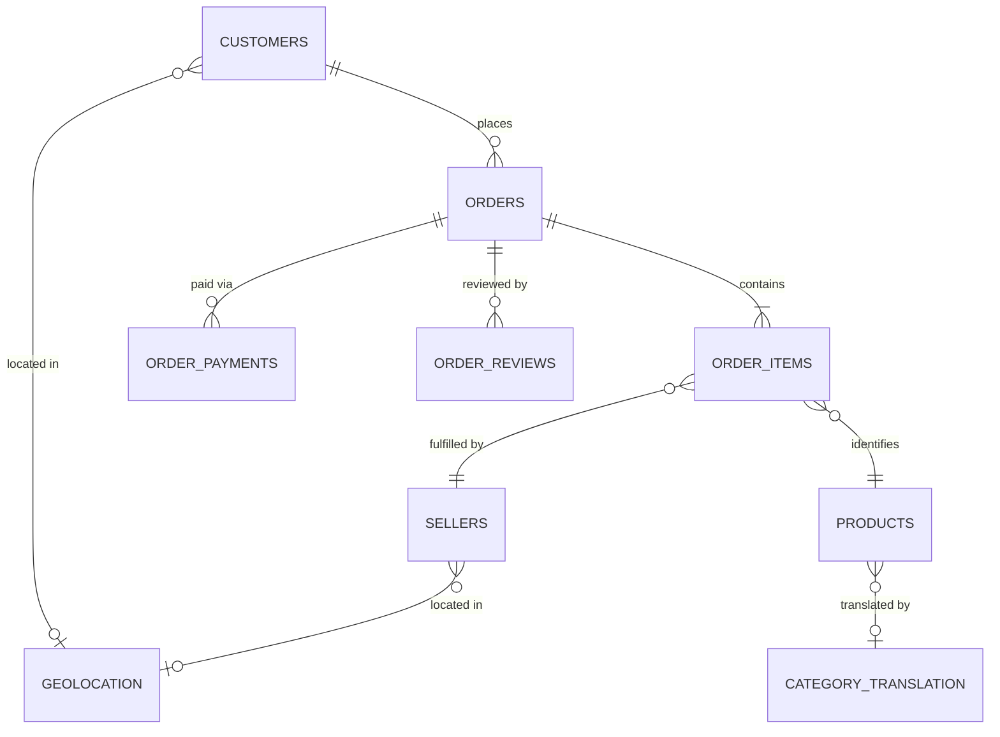

# CommerceLens AI — Olist Dataset Data Dictionary

> **Source**: Public Brazilian E-Commerce Dataset by Olist ([Kaggle](https://www.kaggle.com/datasets/olistbr/brazilian-ecommerce))  
> **Coverage Period**: 2016 to 2018 (~100k orders across Brazilian states)  
> **Status**: Schema blueprint documented in Phase 0. Actual statistical distributions and null rates will be verified upon CSV ingestion in Phase 1 without fabrication.

---

## Relational Entity Overview

---

## 1. Table: `olist_orders_dataset`
- **Primary Key**: `order_id`
- **Grain**: Exactly 1 row per order.
- **Description**: Central backbone of marketplace transactions tracking order lifecycle and timestamps.

| Column Name | Expected Type | Nullable? | Description & Analytical Notes |
|:---|:---|:---:|:---|
| `order_id` | VARCHAR(32) | No | Unique identifier of each transaction. |
| `customer_id` | VARCHAR(32) | No | Transaction-specific customer key (maps to `olist_customers_dataset.customer_id`). **Note**: This changes per order. |
| `order_status` | VARCHAR(20) | No | Order status: `delivered`, `shipped`, `canceled`, `invoiced`, `processing`, `created`, `approved`, `unavailable`. |
| `order_purchase_timestamp` | TIMESTAMP | No | Timestamp of customer checkout purchase. |
| `order_approved_at` | TIMESTAMP | Yes | Payment approval timestamp. Null for some canceled/unapproved orders. Boleto payments may take 1-3 days. |
| `order_delivered_carrier_date` | TIMESTAMP | Yes | Timestamp of package handover to carrier (Correios). Null for unfulfilled orders. |
| `order_delivered_customer_date`| TIMESTAMP | Yes | Actual timestamp when customer received the order. Crucial for on-time calculation. |
| `order_estimated_delivery_date`| TIMESTAMP | No | SLA target promised to the customer at checkout. |

---

## 2. Table: `olist_order_items_dataset`
- **Primary Key**: `(order_id, order_item_id)`
- **Grain**: 1 row per physical item line inside an order.
- **Description**: Contains product line details, selling price, freight, and responsible seller.

| Column Name | Expected Type | Nullable? | Description & Analytical Notes |
|:---|:---|:---:|:---|
| `order_id` | VARCHAR(32) | No | Foreign key referencing `olist_orders_dataset.order_id`. |
| `order_item_id` | INT | No | Sequential item index within the order (1, 2, 3...). Multi-item orders have multiple rows. |
| `product_id` | VARCHAR(32) | No | Foreign key referencing `olist_products_dataset.product_id`. |
| `seller_id` | VARCHAR(32) | No | Foreign key referencing `olist_sellers_dataset.seller_id`. |
| `shipping_limit_date` | TIMESTAMP | No | Seller fulfillment deadline to hand over parcel to carrier. |
| `price` | DECIMAL(10,2) | No | Item selling price in Brazilian Real (BRL). Base for item-level GMV. |
| `freight_value` | DECIMAL(10,2) | No | Shipping fee allocated to this item in BRL. |

---

## 3. Table: `olist_order_payments_dataset`
- **Primary Key**: `(order_id, payment_sequential)`
- **Grain**: 1 row per payment installment or payment slice.
- **Description**: Details how an order was funded (credit card, boleto, voucher, debit).

| Column Name | Expected Type | Nullable? | Description & Analytical Notes |
|:---|:---|:---:|:---|
| `order_id` | VARCHAR(32) | No | Foreign key referencing `olist_orders_dataset.order_id`. |
| `payment_sequential`| INT | No | Payment sequence number (customers can combine multiple payment methods, e.g., voucher + credit card). |
| `payment_type` | VARCHAR(20) | No | Payment method: `credit_card`, `boleto`, `voucher`, `debit_card`, `not_defined`. |
| `payment_installments`| INT | No | Number of credit card installments chosen by customer. |
| `payment_value` | DECIMAL(10,2) | No | Monetary value paid via this method in BRL. Sum of payment values equals total order value (Price + Freight). |

---

## 4. Table: `olist_order_reviews_dataset`
- **Primary Key**: `review_id` (or compound `(review_id, order_id)`)
- **Grain**: 1 row per customer review submission.
- **Description**: Customer satisfaction rating and Portuguese feedback text.

| Column Name | Expected Type | Nullable? | Description & Analytical Notes |
|:---|:---|:---:|:---|
| `review_id` | VARCHAR(32) | No | Unique identifier of review. Note: In rare cases, an order might have multiple review entries. |
| `order_id` | VARCHAR(32) | No | Foreign key referencing `olist_orders_dataset.order_id`. |
| `review_score` | INT | No | Customer rating integer from 1 (terrible) to 5 (excellent). |
| `review_comment_title`| TEXT | Yes | Review header in Portuguese (~11% populated). |
| `review_comment_message`| TEXT | Yes | Detailed customer review comment text in Portuguese (~40% populated). Primary input for Phase 5 NLP. |
| `review_creation_date`| TIMESTAMP | No | Timestamp when satisfaction survey was sent to customer. |
| `review_answer_timestamp`| TIMESTAMP | No | Timestamp when customer submitted their review. |

---

## 5. Table: `olist_customers_dataset`
- **Primary Key**: `customer_id`
- **Grain**: 1 row per unique checkout session.
- **Description**: Connects orders to customer geographic locations and persistent customer identities.

| Column Name | Expected Type | Nullable? | Description & Analytical Notes |
|:---|:---|:---:|:---|
| `customer_id` | VARCHAR(32) | No | Unique key for each order. References `orders.customer_id`. |
| `customer_unique_id`| VARCHAR(32) | No | Persistent identifier of the actual human customer. Used for repurchase rate and customer LTV analysis. |
| `customer_zip_code_prefix`| INT/VARCHAR(5)| No | First 5 digits of Brazilian CEP (postal code). |
| `customer_city` | VARCHAR(100) | No | Customer delivery city. |
| `customer_state` | VARCHAR(2) | No | Brazilian federal state code (2 letters, e.g., SP, RJ, MG). |

---

## 6. Table: `olist_sellers_dataset`
- **Primary Key**: `seller_id`
- **Grain**: 1 row per marketplace merchant.
- **Description**: Identifies merchants selling through Olist.

| Column Name | Expected Type | Nullable? | Description & Analytical Notes |
|:---|:---|:---:|:---|
| `seller_id` | VARCHAR(32) | No | Unique merchant identifier. |
| `seller_zip_code_prefix`| INT/VARCHAR(5)| No | First 5 digits of merchant CEP. Used for seller-customer distance calculation. |
| `seller_city` | VARCHAR(100) | No | Merchant city. |
| `seller_state` | VARCHAR(2) | No | Merchant state code (SP, PR, RJ, etc.). |

---

## 7. Table: `olist_products_dataset`
- **Primary Key**: `product_id`
- **Grain**: 1 row per catalog product SKU.
- **Description**: Product catalog attributes and physical dimensions.

| Column Name | Expected Type | Nullable? | Description & Analytical Notes |
|:---|:---|:---:|:---|
| `product_id` | VARCHAR(32) | No | Unique product SKU. |
| `product_category_name`| VARCHAR(100) | Yes | Category in Portuguese (e.g., `beleza_saude`, `cama_mesa_banho`). |
| `product_name_lenght`| INT | Yes | Character length of product title. |
| `product_description_lenght`| INT | Yes | Character length of product description text. |
| `product_photos_qty`| INT | Yes | Number of published catalog photos. |
| `product_weight_g` | INT | Yes | Product weight in grams. Key predictor for freight cost and carrier delay. |
| `product_length_cm` | INT | Yes | Package length in centimeters. |
| `product_height_cm` | INT | Yes | Package height in centimeters. |
| `product_width_cm` | INT | Yes | Package width in centimeters. |

---

## 8. Table: `olist_geolocation_dataset`
- **Primary Key**: Composite `(geolocation_zip_code_prefix, geolocation_lat, geolocation_lng)`
- **Grain**: Multiple coordinate points per 5-digit zip code prefix.
- **Description**: Lat/Long mappings for Brazilian postal codes. Needs deduplication and centroid aggregation before joining.

| Column Name | Expected Type | Nullable? | Description & Analytical Notes |
|:---|:---|:---:|:---|
| `geolocation_zip_code_prefix`| INT/VARCHAR(5)| No | Brazilian CEP 5-digit prefix. |
| `geolocation_lat` | FLOAT | No | Latitude. |
| `geolocation_lng` | FLOAT | No | Longitude. |
| `geolocation_city` | VARCHAR(100) | No | City name associated with coordinate. |
| `geolocation_state` | VARCHAR(2) | No | State code. |

---

## 9. Table: `product_category_name_translation`
- **Primary Key**: `product_category_name`
- **Grain**: 1 row per Portuguese category name.
- **Description**: Translation dictionary mapping Portuguese categories to English for business reporting.

| Column Name | Expected Type | Nullable? | Description & Analytical Notes |
|:---|:---|:---:|:---|
| `product_category_name` | VARCHAR(100) | No | Portuguese category name (matches `olist_products_dataset.product_category_name`). |
| `product_category_name_english`| VARCHAR(100) | No | English translation (e.g., `health_beauty`, `bed_bath_table`). |

---

## Critical Data Quality Assumptions to Verify in Phase 1
1. **Multi-item & Multi-payment Orders**: An order may have multiple items ($N$) and multiple payment slices ($M$). Never join `order_items` directly with `order_payments` without pre-aggregating, as this creates an $N \times M$ Cartesian explosion.
2. **Delivery Timestamps Missingness**: Orders with status `canceled`, `invoiced`, or `shipped` will legitimately have `NULL` values in `order_delivered_customer_date`. They must be filtered when measuring delivery duration.
3. **Customer ID vs Customer Unique ID**: `customer_id` is a transient session token regenerated on every order; `customer_unique_id` tracks repeat purchases.
4. **Geolocation Multiplicity**: Zip code prefixes contain dozens of varying coordinate samples. Must calculate median or mean centroids per prefix before spatial feature engineering.
