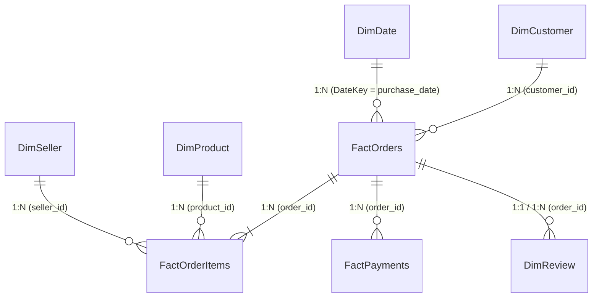

# CommerceLens AI — Power BI Reporting Suite Specification

> **Deliverable**: Production-Ready, 4-Page Business Intelligence Dashboard  
> **Target Audience**: C-Suite Executives, Head of Marketplace Operations, Logistics Directors, Category Managers  
> **Data Model**: Star Schema (Kimball methodology) connected to PostgreSQL / Processed Parquet Views.

---

## 1. Dimensional Data Model & Relationship Topology



### Relationship Design Rules
- All Dimension-to-Fact relationships are **Single Direction (1 to Many)**.
- Bidirectional filtering is strictly avoided to eliminate ambiguity and performance degradation.
- Date filtering flows through a dedicated calendar table: `DimDate`.

---

## 2. Page-by-Page Dashboard Specifications

### Page 1: Executive Overview (Macro Health & Growth)
- **Objective**: Provide leadership with an immediate pulse on marketplace performance, fulfillment efficiency, and customer satisfaction.
- **Top KPI Cards**:
  1. **Total GMV**: Currency formatted (`R$ 0.00 M`).
  2. **Delivered Orders**: Integer formatted with thousands separators.
  3. **Average Order Value (AOV)**: Currency formatted.
  4. **On-Time Delivery Rate**: Percentage formatted with target benchmark line (e.g., `92.0%`).
  5. **Average CSAT (Review Score)**: Gauge visual (1.0 to 5.0) with status coloring.
- **Visual Grid**:
  - **Line & Clustered Column Chart**: Monthly GMV (Columns) vs On-Time Delivery Rate % (Line) over time.
  - **Tree Map**: Top 10 Product Categories by GMV Contribution.
  - **Shape Map / Choropleth**: Brazilian Federal States shaded by GMV and order density.
  - **Donut Chart**: Order Fulfillment Status distribution (`delivered`, `shipped`, `canceled`, `invoiced`).
- **Global Slicers**: Date Period (Year / Quarter / Month), Customer State, Product Super-Category.

---

### Page 2: Sales & Category Intelligence (Merchandising & Economics)
- **Objective**: Enable category managers to evaluate product portfolio health, basket economics, and payment behaviors.
- **Top KPI Cards**:
  1. **Active Product SKUs**: Distinct count of transacted items.
  2. **Active Sellers**: Distinct count of fulfilled merchants.
  3. **Freight Burden Ratio**: `Freight / GMV` percentage.
  4. **Average Items per Basket**: Units per transaction.
- **Visual Grid**:
  - **Pareto Chart (Line & Clustered Column)**: Categories sorted descending by GMV with a cumulative % line to identify the 20% of categories driving 80% of revenue.
  - **Scatter Plot**: Average Item Price vs Sales Volume, sized by Total GMV and colored by Category.
  - **Stacked Bar Chart**: Payment Method Mix (`Credit Card`, `Boleto`, `Voucher`, `Debit Card`) by Order Value Tier.
  - **Table with Heatmap Fill**: Category performance matrix (GMV, AOV, Freight Ratio, Return/Cancellation Rate).
- **Drill-Down Hierarchy**: Super-Category $\to$ Category English $\to$ Product SKU.

---

### Page 3: Logistics & Delivery Operations (Fulfillment & SLA Management)
- **Objective**: Provide logistics managers visibility into supply chain bottlenecks, carrier transit times, and delivery promise accuracy.
- **Top KPI Cards**:
  1. **Late Delivery Rate**: Percentage of delivered orders breaching SLA.
  2. **Avg Total Delivery Lead Time**: Calendar days from checkout to customer door.
  3. **Avg Carrier Transit Days**: Elapsed days between carrier receipt and delivery.
  4. **Avg Seller Dispatch Days**: Elapsed days from order approval to carrier pickup.
- **Visual Grid**:
  - **Histogram / Distribution Chart**: Actual Delivery Days vs Promised SLA Days (identifying SLA cushion vs breaches).
  - **Matrix Visual**: Origin State (Seller) $\times$ Destination State (Customer) showing average delivery transit days with conditional formatting (Green = Fast, Red = Severe delay).
  - **Bar Chart**: Top 10 Delayed Routes (Corridors with highest late delivery percentage, $N \ge 100$).
  - **Stacked Column Chart**: Lead Time Breakdown by Component (Seller Dispatch Time vs Carrier Transit Time) monthly.
- **Drill-Down Hierarchy**: Customer Region $\to$ Customer State $\to$ Customer City.

---

### Page 4: Customer Review & Sentiment Intelligence (CSAT & Voice of Customer)
- **Objective**: Connect logistics performance and product factors directly to customer sentiment and review ratings.
- **Top KPI Cards**:
  1. **CSAT Score**: Overall average rating (1–5 scale).
  2. **Negative Review Share**: Percentage of reviews scoring 1 or 2 stars.
  3. **Review Submission Rate**: Percentage of orders receiving customer feedback.
  4. **Late Order CSAT Penalty**: Difference in average review score between On-Time orders and Late orders.
- **Visual Grid**:
  - **Bar Chart**: Review Score Distribution (1 Star through 5 Stars) with percentage callouts.
  - **Scatter / Line Chart**: Review Score vs Delivery Delay in Days (visualizing the sharp drop in CSAT once delivery exceeds the SLA).
  - **Clustered Bar Chart**: Negative Review Root Cause Breakdown (e.g., Delivery Delay, Damaged Product, Wrong Item, No Updates).
  - **Filterable Verbatim Table**: Review Comment Snippets (Portuguese text + English translation flag + Review Score + Order ID).
- **Slicers**: Review Score (1–5), Delay Flag (`On-Time` vs `Late`), Category.

---

## 3. Core DAX Measure Blueprints

```dax
-- 1. Total GMV (Delivered Orders)
Total GMV = 
CALCULATE(
    SUM(FactOrderItems[price]),
    FactOrders[order_status] = "delivered"
)

-- 2. Total Freight Spend
Total Freight = 
CALCULATE(
    SUM(FactOrderItems[freight_value]),
    FactOrders[order_status] = "delivered"
)

-- 3. Total Delivered Orders
Total Delivered Orders = 
CALCULATE(
    DISTINCTCOUNT(FactOrders[order_id]),
    FactOrders[order_status] = "delivered"
)

-- 4. Average Order Value (AOV)
AOV = 
DIVIDE(
    [Total GMV],
    [Total Delivered Orders],
    0
)

-- 5. On-Time Delivered Orders
On-Time Orders = 
CALCULATE(
    [Total Delivered Orders],
    FactOrders[order_delivered_customer_date] <= FactOrders[order_estimated_delivery_date]
)

-- 6. Late Delivered Orders
Late Orders = 
CALCULATE(
    [Total Delivered Orders],
    FactOrders[order_delivered_customer_date] > FactOrders[order_estimated_delivery_date]
)

-- 7. On-Time Delivery Rate (OTDR)
On-Time Delivery Rate = 
DIVIDE(
    [On-Time Orders],
    [Total Delivered Orders],
    0
)

-- 8. Late Delivery Rate
Late Delivery Rate = 
DIVIDE(
    [Late Orders],
    [Total Delivered Orders],
    0
)

-- 9. Average Review Score (CSAT)
Average Review Score = 
AVERAGE(DimReview[review_score])

-- 10. Late Order CSAT
Late Order CSAT = 
CALCULATE(
    [Average Review Score],
    FactOrders[order_delivered_customer_date] > FactOrders[order_estimated_delivery_date]
)

-- 11. On-Time Order CSAT
On-Time Order CSAT = 
CALCULATE(
    [Average Review Score],
    FactOrders[order_delivered_customer_date] <= FactOrders[order_estimated_delivery_date]
)

-- 12. CSAT Delivery Penalty
CSAT Delivery Penalty = 
[On-Time Order CSAT] - [Late Order CSAT]

-- 13. Pareto Cumulative GMV Percentage
Pareto Cumulative GMV % = 
VAR CurrentGMV = [Total GMV]
VAR TotalMarketGMV = CALCULATE([Total GMV], ALLSELECTED(DimProduct[product_category_name_english]))
VAR RunningSum = 
    CALCULATE(
        [Total GMV],
        FILTER(
            ALLSELECTED(DimProduct[product_category_name_english]),
            [Total GMV] >= CurrentGMV
        )
    )
RETURN
DIVIDE(RunningSum, TotalMarketGMV, 0)
```
