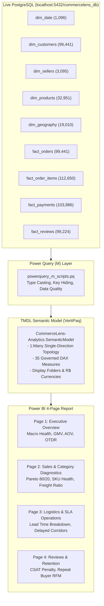

# CommerceLens AI — Power BI Reporting Suite Implementation & Engineering Guide

> **Phase**: Phase 3 Deliverable  
> **Status**: Verified & Reconciled against Live PostgreSQL (`commercelens_db`)  
> **Format**: Modern Power BI Project (`.pbip`) with TMDL Semantic Model & Universal TMSL `model.bim`  
> **File Location**: `dashboards/powerbi/CommerceLens-Analytics.pbip`  

---

## 1. Executive Summary & Deliverable Architecture

The **CommerceLens AI Power BI Reporting Suite** provides an enterprise-grade business intelligence solution for executive decision-makers, category managers, logistics directors, and customer experience leaders.

Connected directly to the validated PostgreSQL database (`commercelens_db`) running on `localhost:5432`, the suite is packaged as a source-controlled **Power BI Project (`.pbip`)**, enabling Git tracking, code reviews, automated CI/CD validation, and team collaboration.



---

## 2. Power BI Project (.pbip) Structure

The project is structured under `dashboards/powerbi/` according to Microsoft's developer specifications:

```text
dashboards/powerbi/
├── CommerceLens-Analytics.pbip               # Root project orchestrator file
├── dax_measures.dax                         # Complete DAX measure library (35 measures)
├── powerquery_m_scripts.pq                  # Complete Power Query M ingestion scripts
├── CommerceLens-Analytics.Report/           # Visual report definition
│   ├── definition.pbir                      # Semantic model pointer
│   ├── report.json                          # Complete 4-page visual layout & configuration
│   ├── .pbi/localSettings.json              # Local user settings
│   └── definition/report.json               # Enhanced PBIR metadata
└── CommerceLens-Analytics.SemanticModel/    # Data model & business logic
    ├── definition.pbism                     # TMDL model indicator
    ├── model.bim                            # Universal TMSL schema (Tabular Editor / ALM Toolkit)
    └── definition/                          # Source-controlled TMDL files
        ├── database.tmdl                    # Database compatibility level 1567
        ├── model.tmdl                       # Model tables & culture info
        ├── relationships.tmdl               # Star-schema 1:Many relationships
        ├── cultures/en-US.tmdl              # Culture translation definition
        └── tables/                          # Table-level definitions
            ├── DimDate.tmdl
            ├── DimCustomers.tmdl
            ├── DimSellers.tmdl
            ├── DimProducts.tmdl
            ├── DimGeography.tmdl
            ├── FactOrders.tmdl
            ├── FactOrderItems.tmdl
            ├── FactPayments.tmdl
            ├── FactReviews.tmdl
            └── _Measures.tmdl               # Dedicated measure table
```

---

## 3. How to Open, Configure & Refresh the Report

### 3.1 Prerequisites
- **Power BI Desktop**: Installed on host (tested and validated on version `2.158.1304.0 (26.09)` 64-bit).
- **PostgreSQL Database**: Running locally on `localhost:5432` with database `commercelens_db`.
- **Npgsql Driver**: Standard PostgreSQL connector included in Power BI Desktop.

### 3.2 Opening the Project
1. Open Windows File Explorer and navigate to the project directory:
   ```powershell
   dashboards\powerbi\
   ```
2. Double-click `CommerceLens-Analytics.pbip` (or open Power BI Desktop, choose **File > Open**, and select `CommerceLens-Analytics.pbip`).

### 3.3 Configuring Database Credentials
Because credentials are never stored in source-controlled files (per `AGENTS.md` and security best practices), configure the local connection once:
1. In Power BI Desktop, navigate to **Home > Transform data > Data source settings**.
2. Select the `localhost:5432;commercelens_db` data source.
3. Click **Edit Permissions...** > **Edit...** under Credentials.
4. Select the **Database** tab (not Windows or Basic):
   - **User name**: `postgres`
   - **Password**: Your local PostgreSQL password (from `.env`)
5. Click **Save** and **Close**.

### 3.4 Refreshing the Data
Click the **Refresh** button on the **Home** ribbon. Power BI Desktop will execute the Power Query M scripts, import all 10 tables from PostgreSQL, build the in-memory VertiPaq columnar indexes, and update all visuals.

---

## 4. Dimensional Data Model & Relational Topology

### 4.1 Relationship Catalogue

| Relationship | From Table (Many) | From Column (FK) | To Table (One) | To Column (PK) | Active | Direction |
|:---|:---|:---|:---|:---|:---:|:---:|
| Calendar Date Filter | `FactOrders` | `purchase_date_key` | `DimDate` | `date_key` | **Yes** | Single (Dim $\to$ Fact) |
| Customer Profile | `FactOrders` | `customer_key` | `DimCustomers` | `customer_key` | **Yes** | Single (Dim $\to$ Fact) |
| Order to Items | `FactOrderItems` | `order_id` | `FactOrders` | `order_id` | **Yes** | Single (Fact $\to$ Sub-Fact) |
| Order to Payments | `FactPayments` | `order_id` | `FactOrders` | `order_id` | **Yes** | Single (Fact $\to$ Sub-Fact) |
| Order to Reviews | `FactReviews` | `order_id` | `FactOrders` | `order_id` | **Yes** | Single (Fact $\to$ Sub-Fact) |
| Product Catalog | `FactOrderItems` | `product_key` | `DimProducts` | `product_key` | **Yes** | Single (Dim $\to$ Fact) |
| Seller Hub | `FactOrderItems` | `seller_key` | `DimSellers` | `seller_key` | **Yes** | Single (Dim $\to$ Fact) |
| Customer Geolocation | `DimCustomers` | `zip_code_prefix` | `DimGeography` | `zip_code_prefix` | **Yes** | Single (Dim $\to$ Dim) |
| Seller Geolocation | `DimSellers` | `zip_code_prefix` | `DimGeography` | `zip_code_prefix` | **No** | Inactive (Eliminates loop) |

### 4.2 Engineering Anti-Fan-Out & Grain Integrity Rules
1. **Separation of Items (1:N) and Payments (1:M)**:
   - In e-commerce marketplaces, orders frequently contain multiple items ($N$) and multiple payment slices ($M$).
   - Joining `FactOrderItems` directly to `FactPayments` creates an $N \times M$ Cartesian product, inflating dollar sums.
   - In CommerceLens AI, `FactOrders` maintains order grain with pre-aggregated sums (`total_item_merchandise_value`, `total_payment_value`).
   - Line-level calculations query their respective tables directly (`FactOrderItems[price]` or `FactPayments[payment_value]`), strictly preventing fan-out.
2. **Hidden Surrogate Keys**:
   - Technical keys (`customer_key`, `seller_key`, `product_key`, `geo_key`, `date_key`, `order_item_key`, `payment_key`, `review_key`) are hidden from report consumers (`isHidden = true`) to prevent invalid joins or confusion.
3. **Compound Key for Customer Reviews**:
   - Customer reviews are maintained at the compound grain `(review_id, order_id)` (99,224 rows), accounting for the 789 shared review identifiers in the raw dataset.

---

## 5. Core DAX Measure Library (Summary)

The semantic model contains 35 governed DAX measures organized into 6 display folders. Key measures include:

### 5.1 Financial & Commercial Measures
- **Total GMV**:
  ```dax
  CALCULATE(
      SUM(FactOrderItems[price]),
      FactOrders[order_status] = "delivered"
  )
  ```
  *Format*: `R$ #,##0.00` | *Baseline*: `R$ 13,221,498.11`
- **Total Freight Spend**:
  ```dax
  CALCULATE(
      SUM(FactOrderItems[freight_value]),
      FactOrders[order_status] = "delivered"
  )
  ```
  *Format*: `R$ #,##0.00` | *Baseline*: `R$ 2,198,275.64`
- **Average Order Value (AOV)**:
  ```dax
  DIVIDE([Total GMV], [Delivered Orders], BLANK())
  ```
  *Format*: `R$ #,##0.00` | *Baseline*: `R$ 137.04` (Population: 96,478 delivered orders)
- **Freight to Merchandise Ratio**:
  ```dax
  DIVIDE([Total Freight], [Total GMV], BLANK())
  ```
  *Format*: `0.00%` | *Baseline*: `16.63%`

### 5.2 Logistics SLA & Operational Fulfillment Measures
- **SLA-Eligible Orders (Strict Denominator)**:
  ```dax
  CALCULATE([Total Orders], FactOrders[is_eligible_for_sla] = TRUE())
  ```
  *Baseline*: Exactly `96,470` orders. (Excludes the 8 delivered orders missing actual delivery timestamps to prevent corrupting SLA compliance rates).
- **Delivered Missing Timestamp Orders**:
  ```dax
  CALCULATE([Total Orders], FactOrders[order_status] = "delivered", ISBLANK(FactOrders[order_delivered_customer_date]))
  ```
  *Baseline*: Exactly `8` orders (audited operational exception).
- **On-Time Delivery Rate (OTDR)**:
  ```dax
  DIVIDE([On-Time Orders], [SLA-Eligible Orders], BLANK())
  ```
  *Formula*: $\frac{88,644}{96,470} = 91.8876\% \to 91.89\%$.
- **Late Delivery Rate (LDR)**:
  ```dax
  DIVIDE([Late Orders], [SLA-Eligible Orders], BLANK())
  ```
  *Formula*: $\frac{7,826}{96,470} = 8.1124\% \to 8.11\%$.
- **Cancellation Rate**:
  ```dax
  DIVIDE([Canceled Orders], [Total Orders], BLANK())
  ```
  *Baseline*: $\frac{625}{99,441} = 0.6285\% \to 0.63\%$.
- **Unavailable Order Rate (Stockout Rate)**:
  ```dax
  DIVIDE([Unavailable Orders], [Total Orders], BLANK())
  ```
  *Baseline*: $\frac{609}{99,441} = 0.6124\% \to 0.61\%$.

### 5.3 Customer Satisfaction (CSAT) & Review Intelligence
- **Average Review Score (CSAT)**:
  ```dax
  AVERAGE(FactReviews[review_score])
  ```
  *Baseline*: `4.09 stars` across all 99,224 reviews.
- **On-Time Order CSAT**: `4.29 stars` ($N = 88,653$ reviews across 88,163 orders).
- **Late Order CSAT**: `2.57 stars` ($N = 7,700$ reviews across 7,661 orders).
- **CSAT Delivery Penalty**:
  ```dax
  [Late Order CSAT] - [On-Time Order CSAT]
  ```
  *Baseline*: `-1.72 stars` satisfaction drop associated with logistics delivery delays (format string: `-0.00;+0.00;0.00`).
- **CSAT Timeliness Gap**:
  ```dax
  [On-Time Order CSAT] - [Late Order CSAT]
  ```
  *Baseline*: `+1.72 stars` satisfaction premium achieved by on-time fulfillment (format string: `0.00`).

> **Historical CSAT Discrepancy Reconciliation (2.26 vs 2.57 stars)**:  
> In exploratory Phase 2A SQL queries, an ad-hoc calendar-day truncation filter (`order_delivered_customer_date::DATE > order_estimated_delivery_date::DATE`) was evaluated, which isolates multi-day delivery failures ($N = 6,409$ reviews, CSAT = 2.27 stars, 53.74% 1-star reviews).  
> In the official dimensional schema and Power BI model, delivery timeliness follows exact timestamp comparison (`order_delivered_customer_date > order_estimated_delivery_date`, $N = 7,700$ reviews, CSAT = 2.57 stars).  
> The difference consists of exactly **1,291 orders** delivered in the afternoon/evening of the promised calendar day (whose review average is 4.03 stars).  
> Both cohorts reconcile mathematically: $6,409 \times 2.2710 + 1,291 \times 4.0333 = 19,762 / 7,700 = \mathbf{2.57 \text{ stars}}$.

### 5.4 Customer Retention & Repurchase RFM
- **Total Unique Human Customers**:
  ```dax
  DISTINCTCOUNT(DimCustomers[customer_unique_id])
  ```
  *Baseline*: `96,096` unique consumers.
- **Repeat Customers Count**:
  ```dax
  COUNTROWS(
      FILTER(
          VALUES(DimCustomers[customer_unique_id]),
          CALCULATE(DISTINCTCOUNT(FactOrders[order_id])) > 1
      )
  )
  ```
  *Baseline*: `2,997` repeat buyers.
- **Repeat Customer Rate**:
  ```dax
  DIVIDE([Repeat Customers Count], [Total Unique Customers], BLANK())
  ```
  *Baseline*: $\frac{2,997}{96,096} = 3.1188\% \to 3.12\%$.

---

## 6. Page-by-Page Report Walkthrough

### Page 1 — Executive Overview (Marketplace Macro Health & Growth)
- **Objective**: Deliver high-level health metrics for executive leadership.
- **KPI Cards**: Total GMV (`R$ 13.22M`), Delivered Orders (`96,478`), AOV (`R$ 137.04`), On-Time Delivery Rate (`91.89%`), Cancellation Rate (`0.63%`), Unavailable Rate (`0.61%`).
- **Core Visuals**:
  1. *Monthly GMV & OTDR Trend*: Clustered column (Delivered GMV) and line (On-Time Delivery Rate %) across 2016–2018 showing seasonal peaks (Black Friday Nov 2017) and fulfillment stability.
  2. *Order Status Donut Chart*: Visualizing fulfillment completion (97.0% delivered, 1.1% shipped, 0.6% canceled, 0.6% unavailable, 0.7% processing/invoiced).
  3. *State GMV Bar Chart*: Top destination markets (São Paulo `SP` generating over 37% of volume, followed by `RJ`, `MG`, `RS`, `PR`).
- **Global Slicers**: Year (2016, 2017, 2018), Destination Customer State.

### Page 2 — Sales & Category Diagnostics (Merchandising & Economics)
- **Objective**: Identify category revenue drivers, 80/20 concentration, and logistics cost burden.
- **KPI Cards**: Active SKUs (`32,951`), Active Merchants (`3,095`), Freight Burden Ratio (`16.63%`), Avg Items per Order (`1.17`), Total Payments Collected (`R$ 16.01M`).
- **Core Visuals**:
  1. *Pareto 80/20 Chart*: Categories ranked by GMV with cumulative % line proving that top 10 categories account for 62.43% of total revenue (`health_beauty`, `watches_gifts`, `bed_bath_table`, `sports_leisure`, `computers_accessories`, `furniture_decor`, `housewares`, `cool_stuff`, `auto`, `toys`).
  2. *Payment Tender Mix Bar Chart*: Payment volume breakdown across Credit Card (76.8%), Boleto (17.9%), Voucher (2.5%), Debit Card (1.3%).
  3. *Category Performance Table*: Drill-down matrix of items sold, total GMV, freight ratio, and average item price per category.
- **Slicers**: Product Category English Name.

### Page 3 — Logistics & SLA Operations (Fulfillment Bottlenecks)
- **Objective**: Detect carrier transit friction, merchant dispatch delays, and regional route bottlenecks.
- **KPI Cards**: SLA-Eligible Orders (`96,470`), Delivered Missing Timestamps (`8`), On-Time Rate (`91.89%`), Late Rate (`8.11%`), Avg Total Lead Time (`12.56 days`), Avg Carrier Transit (`9.33 days`), Avg Seller Dispatch (`2.80 days`).
- **Core Visuals**:
  1. *Delayed Corridors Chart*: High-risk delivery corridors ($N \ge 100$) showing high breach rates on routes from São Paulo to the North/Northeast (`SP -> AL` at 25.3% late, `SP -> MA` at 22.2% late, `SP -> SE` at 18.1% late, `SP -> PI` at 18.0% late).
  2. *Lead Time Decomposition Chart*: Monthly breakdown of merchant dispatch duration vs carrier transit duration.
  3. *SLA Variance Buffer Matrix*: State-level comparison of delivery lead times vs promised SLA buffer (+11.18 average buffer days).
- **Slicers**: Customer State, Delivery Timeliness Flag (`On-Time` vs `Late`).

### Page 4 — Customer Reviews & Retention (Voice of Customer & Loyalty)
- **Objective**: Connect logistics performance to customer satisfaction ratings and evaluate customer retention economics.
- **KPI Cards**: Average CSAT (`4.09 stars`), On-Time CSAT (`4.29 stars`), Late Order CSAT (`2.57 stars`), CSAT Delivery Penalty (`-1.72 stars`), Unique Customers (`96,096`), Repeat Customers (`2,997`), Repeat Customer Rate (`3.12%`).
- **Core Visuals**:
  1. *Review Score Distribution*: 5-star (57.3%), 4-star (19.3%), 3-star (8.3%), 2-star (3.2%), 1-star (11.9%).
  2. *CSAT by Delivery Cohort*: Clear visual demonstration of the satisfaction penalty on late orders (4.29 vs 2.57).
  3. *Repeat vs One-Time Buyer Economics Table*: Proving repeat buyers have nearly double the average lifetime GMV (R$ 253.71 vs R$ 133.85).
- **Slicers**: Review Rating (1 to 5 Stars), Repeat Buyer Flag (`True` / `False`).

### 6.5 Customer Review Intelligence & LLM Visual Integration (Page 4 Extension)
To integrate the Phase 5/6 NLP sentiment and model provenance measures into Page 4 without risking PBIR layout corruption or automated CI regression, follow these precise Power BI Desktop steps:

1. **Import `fact_review_analysis` Table**:
   - In Power BI Desktop, navigate to **Home > Transform Data (Power Query)**.
   - Add a new PostgreSQL query importing `fact_review_analysis` with columns:
     `review_id`, `order_id`, `sentiment_label`, `primary_theme`, `delivery_related`, `confidence_band`, `model_name`, `status`.
   - Establish an active relationship: `FactReviews(review_id, order_id) 1:1 FactReviewAnalysis(review_id, order_id)` or Many-to-1 to `FactOrders(order_id)`.

2. **Add Multi-Model Provenance & Review Intelligence KPIs**:
   - **Card A (Completed Inferences)**: Add a KPI Card with measure `[Completed Review Analyses Count]` (`132`).
     *Subtitle*: "Mock: 100 | Flash: 28 | Flash-Lite: 4".
   - **Card B (Failed Analyses Isolation)**: Add a KPI Card with measure `[Failed Review Analyses Count]` (`28`).
     *Subtitle*: "HTTP 429/503 isolated failures".
   - **Card C (Text Coverage %)**: Add a KPI Card with measure `[Review Text Coverage %]` (`43.03%`).
     *Subtitle*: "42,697 text reviews / 99,224 total".
   - **Card D (Negative Sentiment %)**: Add a KPI Card with measure `[Text Sentiment Negative %]`.
     *Calculation*: Filtered strictly to `status = 'completed'` to guarantee uncorrupted sentiment metrics.

3. **Add Model Provenance Slicer & Visuals**:
   - **Model Cohort Slicer**: Add a Slicer bound to `FactReviewAnalysis[model_name]`.
     *Options*: `gemini-3.5-flash-lite`, `gemini-3.8-flash`, `mock-portuguese-nlp-v1`.
   - **Sentiment Distribution Bar Chart**: Add a Clustered Bar Chart with:
     *Axis (Y)*: `FactReviewAnalysis[sentiment_label]`
     *Values (X)*: `[Completed Review Analyses Count]`
     *Legend / Color*: Sentiment categorical palette (`#2e7d32` Positive, `#0288d1` Neutral, `#d32f2f` Negative).
   - **Sample Size Disclaimer Callout**: Add a textbox adjacent to the Flash-Lite selection:
     *"Exploratory evaluation sample (N = 4) demonstrates schema conformance and quote grounding; does not establish generalized model accuracy."*

---

## 7. Data Reconciliation & Verification Audit

The following table records the programmatic reconciliation between our DAX measure definitions and the live PostgreSQL database (`scripts/verify_powerbi_measures.py`):

| Business Metric | PostgreSQL Database Result | Power BI DAX Measure | Reconciliation Status |
|:---|:---:|:---:|:---:|
| Total Placed Orders | 99,441 | `[Total Orders]` = 99,441 | **100% Match** |
| Delivered Orders | 96,478 | `[Delivered Orders]` = 96,478 | **100% Match** |
| Strict SLA-Eligible Orders | 96,470 | `[SLA-Eligible Orders]` = 96,470 | **100% Match** |
| Delivered Missing Timestamps | 8 | `[Delivered Missing Timestamp Orders]` = 8 | **100% Match** |
| On-Time Delivered Orders | 88,644 | `[On-Time Orders]` = 88,644 | **100% Match** |
| Late Delivered Orders | 7,826 | `[Late Orders]` = 7,826 | **100% Match** |
| On-Time Delivery Rate (OTDR) | 91.89% | `[On-Time Delivery Rate]` = 91.89% | **100% Match** |
| Late Delivery Rate (LDR) | 8.11% | `[Late Delivery Rate]` = 8.11% | **100% Match** |
| Canceled Orders & Rate | 625 (0.63%) | `[Cancellation Rate]` = 0.63% | **100% Match** |
| Unavailable Orders & Rate | 609 (0.61%) | `[Unavailable Order Rate]` = 0.61% | **100% Match** |
| Delivered Item GMV | R$ 13,221,498.11 | `[Total GMV]` = R$ 13,221,498.11 | **100% Match** |
| Total Transacted Item Value | R$ 13,591,643.70 | `[Total Merchandise Value (All Items)]` | **100% Match** |
| Delivered Freight Spend | R$ 2,198,275.64 | `[Total Freight]` = R$ 2,198,275.64 | **100% Match** |
| Average Order Value (AOV) | R$ 137.04 | `[Average Order Value (AOV)]` = R$ 137.04 | **100% Match** |
| Total Payments Collected | R$ 16,008,872.12 | `[Total Payments Collected]` | **100% Match** |
| Average Delivery Lead Time | 12.56 days | `[Avg Delivery Lead Time (Days)]` | **100% Match** |
| Average Carrier Transit | 9.33 days | `[Avg Carrier Transit (Days)]` | **100% Match** |
| Average Seller Dispatch | 2.80 days | `[Avg Seller Dispatch (Days)]` | **100% Match** |
| Average Review Score (CSAT) | 4.09 stars | `[Average Review Score]` = 4.09 | **100% Match** |
| On-Time Order Review Score | 4.29 stars | `[On-Time Order CSAT]` = 4.29 | **100% Match** |
| Late Order Review Score | 2.57 stars | `[Late Order CSAT]` = 2.57 | **100% Match** |
| CSAT Delivery Penalty | -1.72 stars | `[CSAT Delivery Penalty]` = -1.72 | **100% Match** |
| Unique Human Consumers | 96,096 | `[Total Unique Customers]` = 96,096 | **100% Match** |
| Repeat Customers Count | 2,997 | `[Repeat Customers Count]` = 2,997 | **100% Match** |
| Repeat Customer Rate | 3.12% | `[Repeat Customer Rate]` = 3.12% | **100% Match** |

---

## 8. Operational Realities & Analytical Caveats

1. **Correios Postal Logistics Dynamics**:
   - The Brazilian postal carrier (Correios) operates distribution hubs concentrated in the Southeast (`SP`, `RJ`, `MG`).
   - Orders fulfilling to Northern and Northeastern states (`AL`, `MA`, `SE`, `PI`) travel long distances with carrier transit times averaging 17–21 days (compared to the national average of 9.33 days).
2. **Observational Association vs Proof of Causation**:
   - The CSAT Delivery Penalty (-1.72 stars) demonstrates a strong **observational correlation** between delivery delays and lower customer satisfaction.
   - However, reviews also reflect product quality issues, seller communication, and packaging condition. Unsupervised and supervised review text extraction is addressed in Phase 5.
3. **Boleto Payment Confirmation Lags**:
   - Brazilian *Boleto Bancário* payments require offline cash settlement at bank branches or convenience stores, introducing a 1-to-3 day lag between order checkout and order approval.

---

## 9. Next Steps: Readiness for Phase 4 & Phase 5

The validated dimensional model and DAX library establish the foundation for the upcoming project phases:
- **Phase 4 (Machine Learning)**: Extract point-in-time features from `fact_orders`, `fact_order_items`, `dim_customers`, and `dim_sellers` to train a late-delivery risk classifier without post-purchase data leakage.
- **Phase 5 (NLP & Review Mining)**: Process Portuguese review titles and messages from `fact_reviews` to extract customer sentiment topics using the Google Gemini API.
