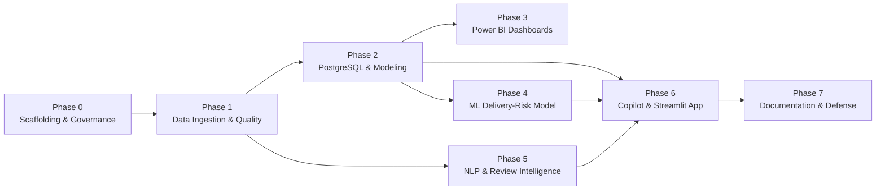

# CommerceLens AI — Master Project Implementation Plan

> **Project Goal**: Build an interview-grade, enterprise-ready E-Commerce Analytics, Machine Learning, and AI Copilot platform using the Olist Brazilian E-Commerce dataset.  
> **Guiding Principle**: Rigorous Data Engineering, validated SQL analytics, clean star-schema modeling, leakage-free predictive modeling, evidence-grounded AI copilot, and defensible business insights.

---

## Roadmap Overview

---

## Phase-by-Phase Execution Breakdown

### Phase 0: Scaffolding, Governance & Engineering Foundations (Current Phase)
- **Objective**: Establish repo layout, coding standards, environment validation, and governance rules.
- **Deliverables**:
  - `AGENTS.md` (persistent project rules, truthfulness contract, no-fabrication policy).
  - `.gitignore`, `.env.example`, `pyproject.toml`.
  - Master documentation: `PROJECT_PLAN.md`, `DATA_DICTIONARY.md`, `METRICS.md`, `ARCHITECTURE.md`, `POWERBI_DASHBOARD_SPEC.md`.
  - Package structure under `src/commercelens/` and minimal smoke tests.
- **Verification**: `pytest -m smoke` passing; Git repository initialized and clean.

---

### Phase 1: Data Ingestion, Profiling & Quality Engineering
- **Objective**: Inspect raw Olist CSVs, perform systematic exploratory data analysis (EDA), detect anomalies, and build a deterministic cleaning pipeline.
- **Key Tasks**:
  1. Manual placement of raw CSVs in `data/raw/` by the user (no automated assumptions).
  2. Ingestion script reading all 9 CSV files with explicit dtypes.
  3. Data quality checks:
     - Null value analysis (e.g., missing delivery dates for canceled/in-transit orders).
     - Primary key uniqueness & duplicate record detection.
     - Foreign key referential integrity (e.g., unmapped customer IDs or product IDs).
     - Timestamp parsing and chronological ordering validation (`purchase` $\le$ `approved` $\le$ `carrier` $\le$ `delivered`).
     - Brazilian Portuguese text encoding (`utf-8` / `latin-1`).
  4. Generation of reproducible cleaned datasets saved to `data/processed/` (Parquet/CSV).
  5. Automated Data Quality Report generated in `reports/data_quality_report.md`.
- **Validation Criteria**: Zero unhandled nulls in primary/foreign keys; 100% referential integrity in cleaned datasets; verified row counts documented.
- **Interview Defense Point**: Why cleaning logic is handled in reproducible code rather than manual Excel edits or ad-hoc notebook cells.

---

### Phase 2: Relational Modeling & Advanced PostgreSQL Analytics
- **Objective**: Architect a performant dimensional model (Star Schema) in PostgreSQL and write business-critical SQL queries.
- **Key Tasks**:
  1. Design DDL schemas (`sql/schema/`):
     - Fact tables: `fact_orders`, `fact_order_items`, `fact_payments`.
     - Dimension tables: `dim_customers`, `dim_sellers`, `dim_products`, `dim_geography`, `dim_date`.
  2. Implement idempotent data loading scripts using SQLAlchemy / `psycopg2`.
  3. Write analytical SQL queries (`sql/analysis/`):
     - Window functions (e.g., rolling 30-day GMV, cumulative revenue, customer repurchase rank).
     - Common Table Expressions (CTEs) for multi-level aggregations without join fan-out.
     - Cohort retention and customer lifetime value (LTV) estimation.
     - Logistics bottleneck identification (carrier transit times vs seller processing lead time).
  4. Create validated SQL views (`sql/views/`) serving as the single source of truth for reporting and Copilot retrieval.
- **Validation Criteria**: Exact equality between SQL aggregated GMV and raw item sums; query execution plans (`EXPLAIN ANALYZE`) inspected for index efficiency.
- **Interview Defense Point**: How to avoid join fan-out and double counting when joining orders (1), items ($N$), payments ($M$), and reviews ($K$).

---

### Phase 3: Power BI Dashboards & Business Reporting
- **Objective**: Develop an executive-ready, 4-page Power BI reporting suite connected to the PostgreSQL dimensional model.
- **Key Pages**:
  1. **Executive Overview**: High-level GMV, total orders, average delivery time, CSAT proxy, regional distribution.
  2. **Sales & Category Intelligence**: Category revenue, Pareto analysis (80/20 rule), basket size, payment method distribution.
  3. **Logistics & Delivery Operations**: Promised SLA vs actual delivery date, carrier transit delays, regional risk hotspots.
  4. **Customer Review Intelligence**: Score distribution, delivery delay vs rating correlation, negative review themes.
- **Deliverables**: Power BI template (`.pbit`), DAX measure library, and visual design documentation.
- **Validation Criteria**: DAX measures match SQL views to 2 decimal places; clean star schema with unidirectional 1-to-many relationships (no bidirectional cross-filtering).
- **Interview Defense Point**: Dimensional modeling best practices (Kimball methodology), why DAX measures use `DIVIDE()` for safe division, and how to structure a reporting semantic layer.

---

### Phase 4: Machine Learning — Delivery-Risk Prediction
- **Objective**: Build and evaluate a classification model predicting whether an order will be delivered late, using strictly point-in-time features.
- **Key Tasks**:
  1. Define the prediction target: `is_late = 1` if `order_delivered_customer_date > order_estimated_delivery_date` else `0`.
  2. Feature engineering (strictly at order/approval time):
     - Distance estimation between customer and seller zip code prefixes.
     - Freight value, freight-to-price ratio, item count, total weight, product volume.
     - Temporal features: Day of week, month, seasonality, holiday proximity.
     - Historical seller performance prior to the order timestamp (point-in-time rolling average).
  3. Prevent data leakage: Exclude carrier handover dates and delivery timestamps.
  4. Train/Test Split: Chronological split (e.g., train on first 80% of historical timeline, test on final 20%).
  5. Baseline model: Dummy classifier and Logistic Regression.
  6. Advanced models: Random Forest, LightGBM / CatBoost.
  7. Metrics: Precision, Recall, F1, PR-AUC, Confusion Matrix (prioritizing recall of late deliveries under constrained false alarms).
  8. Model explainability: SHAP values and feature importance rankings.
- **Validation Criteria**: Clear benchmark improvement over baseline; reproducible seed; documented PR-AUC.
- **Interview Defense Point**: How to prevent target leakage in logistics ML, handle heavy class imbalance (~8% positive class), and select business-aligned decision thresholds.

---

### Phase 5: NLP & Customer Review Intelligence
- **Objective**: Extract actionable intelligence from Portuguese review comments using NLP and LLM APIs.
- **Key Tasks**:
  1. Text preprocessing for Brazilian Portuguese (stopword removal, lemmatization/stemming, accent handling).
  2. Sentiment classification and topic modeling (logistics delay, product defect, wrong item, customer service).
  3. LLM provider abstraction layer (`commercelens.llm`):
     - Integration with Google Gemini API using structured JSON output (Pydantic schema).
     - Validation of LLM classifications on a human-audited or rule-labeled evaluation sample ($N \ge 200$).
  4. Extraction of customer pain points with quantitative attribution to delivery delay.
- **Validation Criteria**: Evaluation sample precision/recall documented; API token usage tracked and budgeted; zero API keys committed.
- **Interview Defense Point**: Trade-offs between classical Portuguese NLP (e.g., TF-IDF, NLTK) vs Few-Shot LLM prompt engineering, and how to evaluate LLM accuracy systematically.

---

### Phase 6: Analytics Copilot & Streamlit Web Platform
- **Objective**: Build a cohesive, interactive web application uniting analytics dashboards, ML inference, review insights, and an evidence-grounded AI Copilot.
- **Key Tasks**:
  1. Streamlit application architecture (`src/commercelens/app/`):
     - Tab 1: Executive KPI Dashboard (interactive Plotly charts).
     - Tab 2: Logistics Delay Forecaster (interactive scenario testing using the trained ML model).
     - Tab 3: Customer Sentiment Explorer (review search, topic filters, verbatim drill-down).
     - Tab 4: Natural Language Analytics Copilot.
  2. Grounded Copilot Architecture:
     - User asks question in natural language.
     - Copilot matches question to approved analytical queries / metric calculator functions.
     - Returns validated metric, contextual interpretation, sample size, and caveat statement.
     - Rejects out-of-scope or ungrounded queries.
- **Validation Criteria**: App runs smoothly with zero unhandled exceptions; responsive UI with empty states and error boundaries; zero arbitrary SQL execution.
- **Interview Defense Point**: How to build safe, hallucination-resistant LLM agents for business intelligence without giving raw database write/read access.

---

### Phase 7: Final Validation, Documentation & Interview Defense Prep
- **Objective**: Package the entire repository for portfolio presentation, recruiter review, and technical interviews.
- **Deliverables**:
  - Comprehensive technical walkthrough in `README.md`.
  - Architecture and metric defense guide (`docs/INTERVIEW_DEFENSE_FAQ.md`).
  - Automated test suite covering end-to-end pipelines (`pytest tests/`).
  - Reproducible run scripts (`scripts/run_pipeline.py`).
