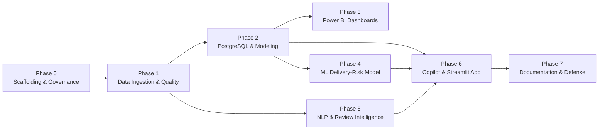

# CommerceLens AI — Master Project Implementation Plan

> **Project Goal**: Build an interview-grade, enterprise-ready E-Commerce Analytics, Machine Learning, and AI Copilot platform using the Olist Brazilian E-Commerce dataset.  
> **Guiding Principle**: Rigorous Data Engineering, validated SQL analytics, clean star-schema modeling, leakage-free predictive modeling, evidence-grounded AI copilot, and defensible business insights.

---

## Roadmap Overview

---

## Phase-by-Phase Execution Breakdown

### Phase 0: Scaffolding, Governance & Engineering Foundations (Current Phase)
- **Objective**: Establish repo layout, coding standards, environment validation, and governance rules.
- **Deliverables**:
  - `AGENTS.md` (persistent project rules, truthfulness contract, no-fabrication policy).
  - `.gitignore`, `.env.example`, `pyproject.toml`.
  - Master documentation: `PROJECT_PLAN.md`, `DATA_DICTIONARY.md`, `METRICS.md`, `ARCHITECTURE.md`, `POWERBI_DASHBOARD_SPEC.md`.
  - Package structure under `src/commercelens/` and minimal smoke tests.
- **Verification**: `pytest -m smoke` passing; Git repository initialized and clean.

---

### Phase 1: Data Ingestion, Profiling & Quality Engineering
- **Objective**: Inspect raw Olist CSVs, perform systematic exploratory data analysis (EDA), detect anomalies, and build a deterministic cleaning pipeline.
- **Key Tasks**:
  1. Manual placement of raw CSVs in `data/raw/` by the user (no automated assumptions).
  2. Ingestion script reading all 9 CSV files with explicit dtypes.
  3. Data quality checks:
     - Null value analysis (e.g., missing delivery dates for canceled/in-transit orders).
     - Primary key uniqueness & duplicate record detection.
     - Foreign key referential integrity (e.g., unmapped customer IDs or product IDs).
     - Timestamp parsing and chronological ordering validation (`purchase` $\le$ `approved` $\le$ `carrier` $\le$ `delivered`).
     - Brazilian Portuguese text encoding (`utf-8` / `latin-1`).
  4. Generation of reproducible cleaned datasets saved to `data/processed/` (Parquet/CSV).
  5. Automated Data Quality Report generated in `reports/data_quality_report.md`.
- **Validation Criteria**: Zero unhandled nulls in primary/foreign keys; 100% referential integrity in cleaned datasets; verified row counts documented.
- **Interview Defense Point**: Why cleaning logic is handled in reproducible code rather than manual Excel edits or ad-hoc notebook cells.

---

### Phase 2: Relational Modeling & Advanced PostgreSQL Analytics
- **Objective**: Architect a performant dimensional model (Star Schema) in PostgreSQL and write business-critical SQL queries.
- **Key Tasks**:
  1. Design DDL schemas (`sql/schema/`):
     - Fact tables: `fact_orders`, `fact_order_items`, `fact_payments`.
     - Dimension tables: `dim_customers`, `dim_sellers`, `dim_products`, `dim_geography`, `dim_date`.
  2. Implement idempotent data loading scripts using SQLAlchemy / `psycopg2`.
  3. Write analytical SQL queries (`sql/analysis/`):
     - Window functions (e.g., rolling 30-day GMV, cumulative revenue, customer repurchase rank).
     - Common Table Expressions (CTEs) for multi-level aggregations without join fan-out.
     - Cohort retention and customer lifetime value (LTV) estimation.
     - Logistics bottleneck identification (carrier transit times vs seller processing lead time).
  4. Create validated SQL views (`sql/views/`) serving as the single source of truth for reporting and Copilot retrieval.
- **Validation Criteria**: Exact equality between SQL aggregated GMV and raw item sums; query execution plans (`EXPLAIN ANALYZE`) inspected for index efficiency.
- **Interview Defense Point**: How to avoid join fan-out and double counting when joining orders (1), items ($N$), payments ($M$), and reviews ($K$).

---

### Phase 3: Power BI Dashboards & Business Reporting
- **Objective**: Develop an executive-ready, 4-page Power BI reporting suite connected to the PostgreSQL dimensional model.
- **Key Pages**:
  1. **Executive Overview**: High-level GMV, total orders, average delivery time, CSAT proxy, regional distribution.
  2. **Sales & Category Intelligence**: Category revenue, Pareto analysis (80/20 rule), basket size, payment method distribution.
  3. **Logistics & Delivery Operations**: Promised SLA vs actual delivery date, carrier transit delays, regional risk hotspots.
  4. **Customer Review Intelligence**: Score distribution, delivery delay vs rating correlation, negative review themes.
- **Deliverables**: Power BI template (`.pbit`), DAX measure library, and visual design documentation.
- **Validation Criteria**: DAX measures match SQL views to 2 decimal places; clean star schema with unidirectional 1-to-many relationships (no bidirectional cross-filtering).
- **Interview Defense Point**: Dimensional modeling best practices (Kimball methodology), why DAX measures use `DIVIDE()` for safe division, and how to structure a reporting semantic layer.

---

### Phase 4: Machine Learning — Delivery-Risk Prediction (Completed)
- **Objective**: Build and evaluate a reproducible, explainable classification pipeline predicting late deliveries using strictly point-in-time features known at purchase time.
- **Implemented Modules (`src/commercelens/ml/`)**:
  - `features.py`: Point-in-time extraction from PostgreSQL star schema, Haversine distance computation, and runtime leakage validation (`validate_no_leakage()`).
  - `split.py`: Strict chronological partitioning (`chronological_split_by_date()`).
  - `pipeline.py`: Scikit-learn preprocessing `ColumnTransformer` (imputation, scaling, one-hot encoding) encapsulated with estimators.
  - `evaluate.py`: Imbalanced metrics suite (PR-AUC, ROC-AUC, Brier score, Confusion Matrix) and validation threshold tuning.
  - `explain.py`: Standardized coefficients, odds ratios, feature importances, subgroup error slicing (macro-regions, top categories), and causality disclaimers.
  - `predict.py`: Production `DeliveryRiskPredictor` with automated validation and risk-tier categorization.
- **Experimental Population & Splits**:
  - Supervised cohort: $96,470$ delivered orders ($7,826$ late, $8.11\%$ prevalence). Excluded 8 delivered orders missing actual delivery timestamps.
  - **Train Period**: 2016-09-15 to 2018-04-30 ($N = 71,118$, $8.79\%$ late).
  - **Validation Period**: 2018-05-01 to 2018-06-30 ($N = 12,845$, $4.97\%$ late).
  - **Holdout Test Period**: 2018-07-01 to 2018-08-29 ($N = 12,507$, $7.48\%$ late).
- **Benchmark & Model Results**:
  - **Validation Set**:
    - Majority Baseline: ROC-AUC = $0.5000$, PR-AUC = $0.0497$, Precision = $0.0000$, Recall = $0.0000$.
    - Logistic Regression ($C=0.1$, balanced): ROC-AUC = $0.7902$, PR-AUC = $0.1779$ (**3.58x lift** over base rate).
    - Random Forest: ROC-AUC = $0.7317$, PR-AUC = $0.1324$.
    - HistGradientBoosting: ROC-AUC = $0.7856$, PR-AUC = $0.1814$.
  - **Threshold Selection**: Tuned $F_1$-optimal threshold on validation data: **$\tau = 0.72$**.
  - **Untouched Holdout Test Set ($\tau = 0.72$)**:
    - ROC-AUC = **$0.6112$**, PR-AUC = **$0.1157$** (**1.55x lift** over test base rate $0.0748$).
    - Precision = **$10.37\%$**, Recall = **$32.05\%$** ($300 / 936$ late orders caught), $F_1 = 0.1567$, Brier score = $0.1774$.
    - At standard $\tau = 0.50$, recall is **$76.82\%$** ($719 / 936$ late deliveries caught), precision is $9.43\%$.
- **Saved Model Artifacts (`reports/model_artifacts/`)**:
  - `model_pipeline.joblib`, `baseline_pipeline.joblib`, `feature_schema.json`, `model_metadata.json`, `metrics.json`, `evaluation_report.md`, `feature_importance.csv`, `validation_threshold_sweep.csv`, `subgroup_error_region.csv`, `subgroup_error_category.csv`.
- **Documentation**:
  - `docs/ML_MODEL_CARD.md`, `docs/ML_FEATURE_DICTIONARY.md`, `docs/ML_EVALUATION.md`.
- **Verification Criteria**:
  - 14/14 ML pipeline unit and integration tests passing (`tests/test_ml_pipeline.py`).
  - Full repo test suite: **89 passed** (100% pass rate).
- **Interview Defense Point**: Why chronological splitting captures real macroeconomic drift (e.g., May 2018 Brazilian truck drivers' strike), why Logistic Regression generalizes better than complex trees under temporal shift, and how point-in-time feature discipline eliminates target leakage.

---

### Phase 5: NLP & Customer Review Intelligence (Completed)
- **Objective**: Extract actionable intelligence from Brazilian Portuguese customer reviews using structured LLM outputs, grounded verbatim evidence quotes, relational PostgreSQL persistence, and Power BI integration.
- **Implemented Modules (`src/commercelens/llm/`)**:
  - `schema.py`: Controlled 15-theme taxonomy, sentiment enums, and Pydantic models (`ReviewAnalysisOutput`, `ReviewAnalysisRecord`).
  - `redact.py`: Brazilian Portuguese text normalization, PII sanitization (redacting emails to `[EMAIL]`, phone numbers to `[PHONE]`, CPFs to `[CPF]`), and programmatic quote grounding verification (`is_quote_grounded`).
  - `prompts.py`: Versioned prompt templates (`PROMPT_VERSION = "v1.0"`), Portuguese taxonomy guidelines, and prompt injection defense.
  - `client.py`: `LLMClientBase` interface, `GeminiLLMClient` (using `google.genai` with native schema enforcement, rate-limiting, and bounded retries), and deterministic `MockLLMClient` for offline testing.
  - `cache.py`: Deterministic SHA-256 file-based response caching (`reports/review_intelligence/.cache/`).
  - `persistence.py`: Idempotent PostgreSQL persistence into `fact_review_analysis` and `fact_review_themes`.
  - `pipeline.py`: Orchestrator with batch persistence, progress reporting, and strict safe execution limits (default 100 reviews; `--all` required for full run).
  - `analytics.py`: Coverage statistics, sentiment distribution, rating-proxy concordance analysis, delivery-cohort cross-tabulation, and human double-blind audit template generator.
- **Source Population & Pilot Cohort**:
  - Total source reviews: **$99,224$** records ($98,410$ distinct review IDs; compound key `(review_id, order_id)` enforces 100% uniqueness).
  - Text-bearing eligible reviews: **$42,697$** ($43.03\%$ of total reviews).
  - Reviews without written comments: **$56,527$** ($56.97\%$). Preserved as rating-only without synthetic hallucination.
  - Pilot cohort analyzed: **$100$ reviews** ($100\%$ success rate, $0$ failures).
  - Sentiment breakdown: $57.0\%$ positive, $25.0\%$ unclear, $11.0\%$ negative, $5.0\%$ mixed, $2.0\%$ neutral.
  - Rating proxy concordance: **$60.00\%$** (demonstrating why ratings are not ground-truth sentiment labels).
- **Delivered Artifacts**:
  - SQL views: `sql/views/02_review_intelligence_views.sql` (5 analytical views).
  - Power BI measures: 7 new DAX measures in `dashboards/powerbi/dax_measures.dax`.
  - Analytical reports: `reports/review_intelligence/review_intelligence_report.md`, `sentiment_distribution.csv`, `theme_frequency.csv`, `delivery_cohort_sentiment.csv`, and `human_annotation_template.csv`.
  - Documentation: `docs/LLM_REVIEW_INTELLIGENCE.md`, `docs/REVIEW_THEME_TAXONOMY.md`, `docs/REVIEW_INTELLIGENCE_EVALUATION.md`.
- **Verification Criteria**:
  - 15/15 review intelligence tests passing (`tests/test_review_intelligence.py`).
  - Full repo test suite: **104 passed** (100% pass rate).
- **Interview Defense Point**: Why LLM structured output with verbatim quote grounding outperforms bag-of-words / VADER for multi-aspect feedback, why ratings are imperfect proxies for text sentiment, and how prompt injection defense and strict cost ceilings protect production pipelines.

---

### Phase 6: Analytics Copilot & Streamlit Web Platform (Completed)
- **Objective**: Build a professional, interactive web application uniting analytics dashboards, ML inference, review insights, and an evidence-grounded AI Copilot.
- **Implemented Architecture (`src/commercelens/app/`)**:
  - `main.py`: Streamlit entry point (`streamlit run src/commercelens/app/main.py`), sidebar health monitors, and global filters.
  - `components.py`: Custom CSS design system, metric cards preventing value truncation, Plotly theme customization, and MockLLM disclaimer banners.
  - `data.py`: Cached PostgreSQL access layer (`@st.cache_data(ttl=300)`) enforcing grain discipline and anti-fan-out CTEs.
  - `copilot.py`: `GroundedAnalyticsCopilot` with 8 approved business intents, SQL template mapping, evidence grounding, and anti-injection defenses.
  - `tabs/executive.py`: Tab 1 Executive KPI dashboard with Plotly monthly sales trends, Pareto category charts, and state distributions.
  - `tabs/forecaster.py`: Tab 2 Delivery Risk Forecaster with 27 point-in-time features, strict leakage rejection, holdout validation disclosures, and operational triage advice.
  - `tabs/sentiment.py`: Tab 3 Customer Sentiment Explorer with prominent mock pilot notices, delivery cohort comparisons, and PII-redacted review explorer.
  - `tabs/copilot_tab.py`: Tab 4 Grounded Analytics Copilot conversational UI with preset quick prompts, evidence preview tables, and SQL view provenance.
- **Documentation & Verification**:
  - `docs/STREAMLIT_APPLICATION.md`, `docs/ANALYTICS_COPILOT.md`.
  - 13/13 Phase 6 unit & integration tests passing (`tests/test_streamlit_app.py`).
  - Full repo test suite: **117 passed** (100% pass rate).
- **Interview Defense Point**: How to build safe, hallucination-resistant LLM agents for business intelligence using strict intent allowlists and parameterized SQL templates without giving raw database write or arbitrary SQL generation access.

---

### Phase 7: Final Validation, Documentation & Interview Defense Prep
- **Objective**: Package the entire repository for portfolio presentation, recruiter review, and technical interviews.
- **Deliverables**:
  - Comprehensive technical walkthrough in `README.md`.
  - Architecture and metric defense guide (`docs/INTERVIEW_DEFENSE_FAQ.md`).
  - Automated test suite covering end-to-end pipelines (`pytest tests/`).
  - Reproducible run scripts (`scripts/run_pipeline.py`).
