# CommerceLens AI — Review Theme Taxonomy & NLP Classification Guide

> **Phase 5 Data Governance Artifact**: Controlled Taxonomy for Brazilian Portuguese Customer Feedback

---

## 1. Overview & Governance Principles

The CommerceLens AI customer review intelligence pipeline categorizes Brazilian Portuguese e-commerce feedback using a controlled, versioned 15-theme taxonomy.

### Cardinal Operating Principles:
1. **Strictly Evidence-Grounded**: A theme is assigned **only** when directly supported by what the customer wrote. Review ratings (1 to 5 stars) are **never** passed into the prompt, preventing rating bias from contaminating theme detection.
2. **Source Language Verbatim Quotes**: Evidence quotes must be exact verbatim substrings extracted from the original review text in Brazilian Portuguese. Hallucinated or translated quotes are rejected programmatically by `validate_and_filter_quotes()`.
3. **Multi-Label Support**: Real-world e-commerce feedback often touches multiple operational aspects (e.g., praising product quality while lamenting transit delay). The system captures a single `primary_theme` alongside a list of secondary `themes`.
4. **Stable Machine-Readable Identifiers**: All downstream SQL views, Python pipelines, and Power BI semantic models reference lowercased snake_case identifiers.

---

## 2. Controlled Theme Taxonomy Register

| Stable Theme Identifier | Category Flag | Polarity Tendency | Definition & Operational Scope | Brazilian Portuguese Examples / Triggers |
|:---|:---:|:---:|:---|:---|
| `delivery_delay` | `delivery` | Negative | Delivery arrived past the promised SLA date, was stuck in transit, or had not arrived after weeks. | *"atrasou muito"*, *"não recebi no prazo"*, *"passou da data estimada"*, *"demorou mais de um mês"* |
| `delivery_tracking` | `delivery` | Negative | Carrier tracking code was invalid, inactive, unupdated, or postal system lacked tracking info. | *"código de rastreio não funciona"*, *"sem atualização nos correios"*, *"não consigo rastrear"* |
| `positive_delivery_experience` | `delivery` | Positive | Order was delivered ahead of schedule, on time, or transport was exceptionally fast. | *"chegou antes do prazo"*, *"entrega super rápida"*, *"veio bem rápido"*, *"pontualidade excelente"* |
| `damaged_or_defective_product` | `product` | Negative | Item arrived physically broken, scratched, cracked, or ceased working upon arrival. | *"veio quebrado"*, *"produto com defeito"*, *"parou de funcionar"*, *"tela rachada"* |
| `product_not_as_described` | `product` | Negative | Item received differs in model, color, dimensions, or technical specifications from the catalog. | *"cor diferente da foto"*, *"propaganda enganosa"*, *"tamanho menor que anunciado"*, *"veio outro modelo"* |
| `missing_or_wrong_item` | `product` | Negative | Package was missing parts/accessories or contained an entirely different product. | *"faltou uma peça"*, *"veio o produto errado"*, *"veio faltando cabo"*, *"comprei tênis e veio camisa"* |
| `poor_product_quality` | `product` | Negative | Material is flimsy, fragile, substandard, or poor durability despite matching description. | *"material muito fraco"*, *"qualidade péssima"*, *"acabamento ruim"*, *"baixa qualidade"* |
| `positive_product_experience` | `product` | Positive | Customer satisfied or delighted with product performance, beauty, utility, or authenticity. | *"ótimo produto"*, *"lindo"*, *"excelente qualidade"*, *"recomendo a todos"*, *"superou as expectativas"* |
| `seller_communication` | `seller` | Negative | Merchant failed to answer questions, was unhelpful, or exhibited rude communication. | *"vendedor não responde"*, *"péssimo atendimento do lojista"*, *"mandei mensagem e ignoraram"* |
| `positive_seller_experience` | `seller` | Positive | Merchant was proactive, polite, answered promptly, or provided dedicated support. | *"vendedor super atencioso"*, *"ótimo atendimento"*, *"lojista tirou todas as dúvidas"* |
| `packaging_issue` | `packaging` | Negative | Outer box crushed, torn, unsealed, or lacked adequate bubble wrap/protection. | *"caixa veio toda amassada"*, *"mal embalado"*, *"sem proteção de plástico bolha"* |
| `payment_or_pricing` | `payment` | Neutral/Neg | Discrepancies regarding price, unexpected charges, payment confirmation, or billing/invoices. | *"cobrança indevida"*, *"demorou para aprovar boleto"*, *"não enviaram nota fiscal"* |
| `return_or_refund` | `returns` | Negative | Customer expresses frustration with return logistics, exchange procedures, or delayed refund. | *"quero devolver"*, *"demora no estorno"*, *"não me respondem sobre a devolução"* |
| `other` | `other` | Variable | Actionable feedback falling outside the core e-commerce operational taxonomy (e.g. mobile app UX). | *"o site travou durante a compra"*, *"problema na navegação"* |
| `unclear` | `unclear` | Unclear | Comment is too brief, ambiguous, incoherent, or emoji-only to identify specific themes. | *"ok"*, *"bom"*, *"sim"*, *"..."*, *"legal"* |

---

## 3. High-Level Category Mapping

For operational dashboards and executive aggregation, themes roll up into high-level Boolean flags:

```mermaid
flowchart TD
    subgraph Themes ["15 Controlled Themes"]
        DD["delivery_delay"]
        DT["delivery_tracking"]
        PDE["positive_delivery_experience"]
        DP["damaged_or_defective_product"]
        PND["product_not_as_described"]
        MWI["missing_or_wrong_item"]
        PPQ["poor_product_quality"]
        PPE["positive_product_experience"]
        SC["seller_communication"]
        PSE["positive_seller_experience"]
        PI["packaging_issue"]
        PP["payment_or_pricing"]
        RR["return_or_refund"]
    end

    subgraph Flags ["Operational Category Flags"]
        DelivFlag["delivery_related"]
        ProdFlag["product_quality_related"]
        SellFlag["seller_service_related"]
        PackFlag["packaging_related"]
        PayFlag["payment_or_pricing_related"]
        RetFlag["returns_or_refunds_related"]
    end

    DD & DT & PDE --> DelivFlag
    DP & PND & MWI & PPQ & PPE --> ProdFlag
    SC & PSE --> SellFlag
    PI --> PackFlag
    PP --> PayFlag
    RR --> RetFlag
```

---

## 4. Evidence Grounding & Verification Rules

1. **Exact Substring Matching**: The function `is_quote_grounded(quote, source_text)` tests whether the extracted quote exists in the sanitized source text.
2. **Accent & Punctuation Relaxation**: If an exact case-insensitive match fails, a fallback normalizes diacritics and removes punctuation, ensuring valid quotes aren't rejected due to punctuation trimming.
3. **Rejection Policy**: If an evidence quote is not found in the source text, it is stripped from `evidence_quotes` and logged as an ungrounded hallucination.
